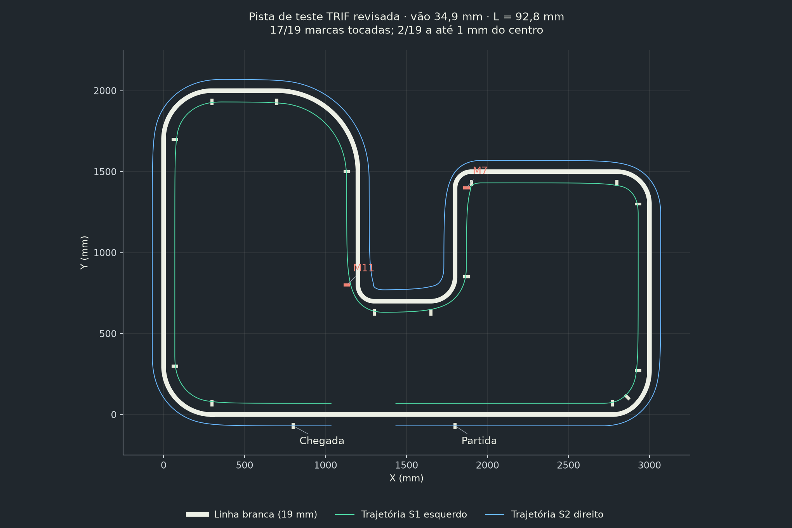
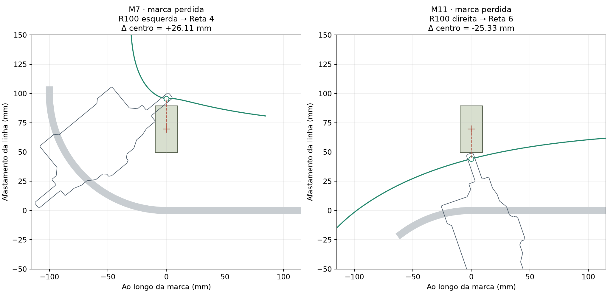

# Volta revisada com o vão estimado do EVA-RT

Configuração: vão base–barra de 34,8885 mm, L de 92,7955 mm e sensores em x = ±69,5 mm, y = 4,5 mm na origem da PCB. Rodas e motores na referência extraída dos STL.

Resultado nominal: **17/19**, com falhas M7 e M11. A região comum às tolerâncias consideradas foi coberta em 14/19. O modelo mantém o ponto virtual frontal sobre o centro da linha e não simula controle PD ou leitura elétrica.

Este é o resultado da revisão 2 do circuito, sem sobreposição entre marcas; não é o resultado do ajuste de 8 mm / 1 mm. A comparação das duas configurações está no README principal.

`analise_volta.json` conserva o resultado bruto com passo de 0,1 mm. `passagens_marcas.csv` é a tabela por marca. `validacao.json` registra a comparação dos passos 0,5 e 0,1 mm, as 19 interseções verificadas por Shapely e a conferência da restrição de corpo rígido. A matriz exploratória de 220 casos não é usada para aprovar este circuito.
