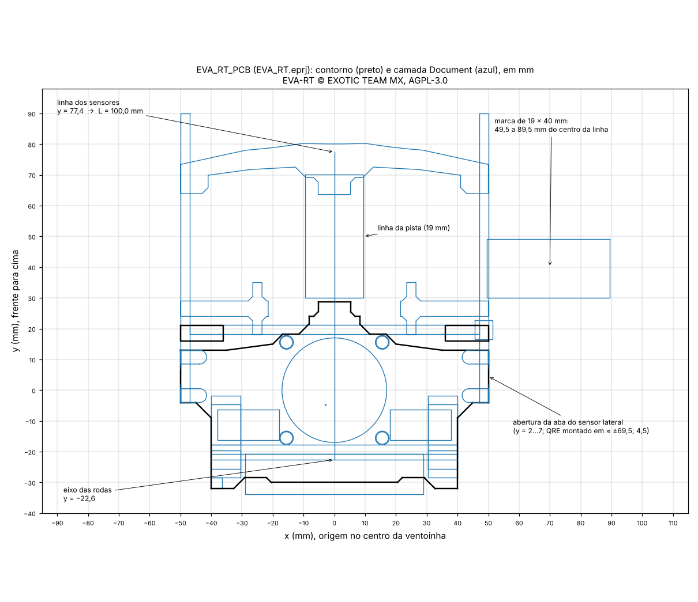

# Por que a v3 "leu pouco" e o que fazer (11/11/2026)

Complementa o [estudo consolidado](../06_estudo_consolidado/README.md). Baseado no EVA-RT, © EXOTIC TEAM MX, [AGPL-3.0](../LICENSE).

## Resposta curta

- **Não precisa mudar o chassi.** A placa v3 (um QRE por lado em X = ±69,5; Y = 4,5) lê todas as marcas dos modelos TRIF 2024, TRIF 2025 e da pista de teste do EVA-RT quando a barra fica a **L = 70 mm do eixo das rodas**. Isso é a decisão de 04/11 (L = 67–70) e corresponde a **26 mm entre o furo da frente da base e o furo da barra V1**.
- A contagem baixa do estudo anterior veio de a barra ter sido posta a 63,14 mm entre furos, que dá **L ≈ 107 mm**. Os 60–70 mm "entre furos" testados ali equivalem a L = 104–114 mm, mais longos que o próprio EVA-RT (L = 100 mm).
- O EVA-RT não lê todas as marcas de curva, e não precisa: o firmware 1.2.2 só usa a marca da direita (chegada) e usa o sensor esquerdo para vetar a parada nos cruzamentos.
- O teste geométrico puro (centro da barra colado na linha) é pessimista para L ≈ 100: nele o EVA-RT falharia na própria pista de teste, o que o vídeo mostra que não acontece.

## 1. O simulador respeita o regulamento?

Sim, no que ele modela. Conferi contra o regulamento do TRIF 2026 (RoboCore, figuras 2 e 4):

| Item | Regulamento | Simulador |
|---|---|---|
| Linha | 19 ± 1 mm | 19 mm |
| Marca | 19 × 40 mm, a 40 mm da borda da linha | 49,5 a 89,5 mm do centro da linha |
| Mudança de curvatura | marca à esquerda | à esquerda, em toda mudança |
| Partida / chegada | à direita, em reta, 1 m entre elas | idem |
| Sensores laterais da v3 | — | (±69,5; 4,5), lidos do arquivo da v3 |
| Eixo das rodas | — | y = −22,59 (STL do EVA-RT) |

A cinemática também está correta: centro da barra sobre a linha, eixo sem escorregar de lado, corpo rígido. O que o simulador **não** modela é o controle: um robô real não mantém o centro da barra exatamente sobre a linha nas curvas (seção 4).

O regulamento da ACRC não pôde ser lido nesta sessão (`www.robotcontest.cl` está fora dos domínios liberados). A equivalência com o TRIF sai do próprio projeto do EVA-RT: a camada Document do `EVA_RT_PCB` desenha a linha de 19 mm e uma marca de 49,5 a 89,5 mm do centro.



## 2. Geometria real do EVA-RT × v3

| Medida | EVA-RT | v3 no estudo anterior | v3 pela decisão de 04/11 |
|---|---:|---:|---:|
| L: eixo → linha dos sensores da barra | 100,0 mm | 107,1 mm | 67–70 mm |
| Furo da frente da base → furo da barra | 56,0 mm* | 63,14 mm | 26,0 mm (L = 70) |
| Sensores laterais | ≈ (±69,5; 4,5) | (±69,5; 4,5) | (±69,5; 4,5) |

\* equivalente com a barra V1; no `.eprj` a reta de referência vai de y = −22,6 (eixo) a y = 77,4 (sensores), exatamente 100 mm. As fotos do repositório do EVA-RT confirmam as abas na borda da placa, com o QRE perto da ponta (largura total de 146 mm).

Conversão: **L = distância entre furos + 43,97 mm**, se a distância for medida a partir do furo da frente da base (y = 10,75). Se os 63,14 mm foram medidos a partir do furo de trás (y = −1,75), L seria 94,6 mm. Vale conferir em qual furo a medida foi feita.

## 3. O que o firmware EVA-RT 1.2.2 faz com as marcas

Em `Marks.ino`:

- borda de subida no sensor **direito** (A6) arma a parada;
- se o sensor **esquerdo** (A5) tiver borda de subida dentro de `MARK_TIMER_MS` (30 ms), a parada é cancelada: os dois sensores viram branco juntos, então é um cruzamento;
- se o esquerdo não disparar, o robô desliga depois de 1 s de corrida: é a chegada.

Não há contagem nem mapeamento de marcas de curva. Para uma volta válida com esse firmware, a geometria precisa garantir três coisas:

1. o sensor direito cruza as marcas de partida e chegada;
2. nos cruzamentos, os dois sensores chegam à linha transversal quase juntos;
3. o sensor direito não passa sobre nenhum outro branco, em especial sobre a própria linha em curvas fechadas à esquerda (seria uma parada falsa).

O script `codigo/analise.py` emula essa lógica sobre as pistas, no domínio da distância (janela = velocidade × 30 ms).

## 4. Resultados

Um QRE por lado em (±69,5; 4,5); centro da barra sobre a linha. Contagens de marcas de curva idênticas às do simulador.

| Pista | Configuração | L | Curva lidas | Região comum | Partida/chegada | Parada do firmware |
|---|---|---:|---:|---:|---:|---|
| TRIF 2025 | v3 a 63,14 mm entre furos | 107,1 | 22/31 | 14/31 | 2/2 | na chegada |
| TRIF 2025 | EVA-RT original | 100 | 24/31 | 19/31 | 2/2 | na chegada |
| TRIF 2025 | v3, L 85 | 85 | 28/31 | 23/31 | 2/2 | na chegada |
| TRIF 2025 | **v3, L 70** | 70 | **31/31** | **31/31** | 2/2 | na chegada |
| TRIF 2024 | v3 a 63,14 mm entre furos | 107,1 | 18/33 | 17/33 | 2/2 | na chegada |
| TRIF 2024 | EVA-RT original | 100 | 21/33 | 17/33 | 2/2 | na chegada |
| TRIF 2024 | v3, L 85 | 85 | 33/33 | 23/33 | 2/2 | na chegada |
| TRIF 2024 | **v3, L 70** | 70 | **33/33** | **33/33** | 2/2 | na chegada |
| EVA-RT teste | v3 a 63,14 mm entre furos | 107,1 | 18/24 | 13/24 | 2/2 | **falsa** (8 disparos) |
| EVA-RT teste | EVA-RT original | 100 | 20/24 | 14/24 | 2/2 | **falsa** (5 disparos) |
| EVA-RT teste | v3, L 85 | 85 | 23/24 | 20/24 | 2/2 | na chegada |
| EVA-RT teste | **v3, L 70** | 70 | **24/24** | **24/24** | 2/2 | na chegada |

Com L = 70 a contagem se mantém completa com ±5 mm de erro lateral fixo nas três pistas. O modelo de 2024 repete a mesma curva de 90° com raio 150 várias vezes, então as contagens dele mudam em blocos.

### O modelo ideal é pessimista para L ≈ 100

Na pista de teste do EVA-RT, com a geometria do próprio EVA-RT, o modelo ideal prevê 20/24 marcas e o sensor direito passando sobre a linha (parada falsa). O vídeo mostra o robô rodando essa pista. A diferença está no controle: um PD sem termo integral precisa de erro para virar, então nas curvas a linha fica deslocada para o lado de dentro da barra e o robô "abre".

Tabela de sensibilidade: o centro da barra é levado para fora da curva em *e* mm numa curva de raio 100 (proporcional à curvatura, com atraso de 40 mm). Célula: marcas de curva lidas · parada do firmware.

| Pista | L | abre 0 mm | abre 10 mm | abre 20 mm | abre 30 mm |
|---|---:|---|---|---|---|
| TRIF 2025 | 107,1 | 22/31 · chegada | 26/31 · chegada | 31/31 · chegada | 31/31 · chegada |
| TRIF 2025 | 100 | 24/31 · chegada | 28/31 · chegada | 31/31 · chegada | 31/31 · chegada |
| TRIF 2025 | 85 | 28/31 · chegada | 31/31 · chegada | 31/31 · chegada | 31/31 · chegada |
| TRIF 2025 | 70 | 31/31 · chegada | 31/31 · chegada | 31/31 · chegada | 31/31 · chegada |
| TRIF 2024 | 107,1 | 18/33 · chegada | 21/33 · chegada | 33/33 · chegada | 33/33 · chegada |
| TRIF 2024 | 100 | 21/33 · chegada | 33/33 · chegada | 33/33 · chegada | 33/33 · chegada |
| TRIF 2024 | 85 | 33/33 · chegada | 33/33 · chegada | 33/33 · chegada | 33/33 · chegada |
| TRIF 2024 | 70 | 33/33 · chegada | 33/33 · chegada | 33/33 · chegada | 33/33 · chegada |
| EVA-RT teste | 107,1 | 18/24 · falsa | 21/24 · falsa | 23/24 · chegada | 24/24 · chegada |
| EVA-RT teste | 100 | 20/24 · falsa | 21/24 · falsa | 23/24 · chegada | 24/24 · chegada |
| EVA-RT teste | 85 | 23/24 · chegada | 24/24 · chegada | 24/24 · chegada | 24/24 · chegada |
| EVA-RT teste | 70 | 24/24 · chegada | 24/24 · chegada | 24/24 · chegada | 24/24 · chegada |

Leitura: com L ≈ 100–107 o resultado depende de quanto o robô abre na curva, o que só se mede na pista. Com L ≤ 85 não há parada falsa em nenhum caso; com L = 70 todas as marcas são lidas em todos os casos. O quanto o robô real abre não foi medido: é uma hipótese para explicar a diferença entre o modelo e o vídeo.

### Curva fechada à esquerda: folga do sensor direito até a borda da linha

Modelo ideal. Folga negativa significa que o centro do sensor passa sobre a linha, o que o firmware trataria como chegada.

| Raio | Ângulo | L 70 | L 85 | L 100 | L 107,1 |
|---:|---:|---:|---:|---:|---:|
| 100 | 90° | 40,0 | 31,8 | 23,1 | 18,9 |
| 100 | 180° | 35,3 | 21,7 | 5,5 | **−3,0** |
| 110 | 180° | 37,9 | 25,6 | 10,8 | 3,0 |
| 120 | 180° | 40,0 | 28,8 | 15,3 | 8,1 |
| 150 | 180° | 44,5 | 35,8 | 25,2 | 19,5 |

O regulamento permite raio de 100 mm. Os modelos do TRIF 2024 e 2025 não têm um grampo assim (menores raios de 150 e 106,5 mm, em arcos de 90°), mas a pista de 2026 pode ter.

### Um único sensor por lado com L longo não resolve

Varredura de L e da posição Y do sensor ([tabelas completas](dados/tabelas.md)): no modelo ideal, com L = 100 só há leitura completa nos dois modelos do TRIF com Y ≥ 30 mm, à frente do nariz da placa (y = 25,6), e mesmo assim a pista do EVA-RT fica em 22/24. Mudar só o X também não resolve: com L = 100 e Y = 4,5, o melhor X único (entre 55 e 65 mm) lê no máximo 27/31, 29/33 e 21/24. As marcas perdidas ficam ora para dentro, ora para fora, conforme a curva; por isso o estudo anterior só fechou a conta com dois sensores por lado. Encurtar L resolve com um.

## 5. Recomendação

**Manter a placa v3 como está** (um QRE por lado). O chassi de dois sensores por lado alarga a placa em 16,5 mm, exige novo layout, mais duas entradas analógicas e mudança no firmware, que hoje só lê A5 e A6. Ele resolve por força bruta um problema que vem do L longo.

L é ajuste mecânico (vareta), não da PCB: dá para decidir e corrigir depois que a placa chegar. As três posições úteis:

| L | Entre furos* | Vão nariz–barra | O que entrega | Custo |
|---:|---:|---:|---|---|
| **70** | 26 mm | 12 mm | lê todas as marcas nas três pistas, mesmo no modelo ideal e com ±5 mm de erro; 35 mm de folga num grampo R100 | 30% menos antecipação que o EVA-RT |
| 85 | 41 mm | 27 mm | nenhuma parada falsa em nenhum caso; 28/31, 33/33 e 23/24 no modelo ideal, todas se o robô abrir 10 mm | 15% menos antecipação |
| 100 | 56 mm | 42 mm | igual ao EVA-RT; volta válida nos modelos do TRIF com o firmware 1.2.2 | leitura das marcas de curva e folga em grampos R100 dependem de o robô abrir na curva |

\* a partir do furo da frente da base (y = 10,75).

- Se ler todas as marcas é requisito, usar **L = 70**. É a única posição em que isso não depende do comportamento do controle.
- O estudo anterior registrava a preferência por "distância base–barra igual à do EVA-RT, com alteração pequena". Nesse caso a posição é L = 100 (56 mm entre furos), não 63,14 mm, que é 7 mm mais longa que a do EVA-RT e é a pior das três em tudo.
- Não passar de L = 100.

Custo de encurtar L: menos antecipação. O ganho da malha cai na proporção de L, então KP e KD precisam ser reajustados; isso já seria necessário por causa dos motores e das pontes diferentes.

## 6. Limites desta análise

- As três pistas são modelos aproximados: as do TRIF vêm de fotos e rascunho, e a do EVA-RT de um quadro de vídeo retificado (escala com incerteza de cerca de 3%).
- Não há PID, motor, óptica, derrapagem nem tempo. "Lê a marca" significa que o centro do QRE cruza o retângulo.
- A emulação do firmware supõe o robô largando perto da marca de partida, de modo que ela caia no primeiro segundo, em que o firmware ignora a parada. Se o robô demorar mais de 1 s para chegar à marca de partida, ele para nela.
- A pista de teste do EVA-RT tem três cruzamentos, raios de 101 a 208 mm e trechos a menos de 200 mm entre si; é uma pista de treino, não regulamentar.
- Nenhum teste físico foi feito.

## 7. Arquivos

| Arquivo | Conteúdo |
|---|---|
| `codigo/analise.py` | cinemática, branco visto por cada sensor, emulação de `Marks.ino`, modelo de "abrir na curva" |
| `codigo/gerar_resultados.py` | gera `dados/resultados.json` e `dados/tabelas.md` |
| `codigo/figura_eva_rt_document.py` | figura da camada Document do `EVA_RT.eprj` |
| `dados/` | resultados completos e tabelas |

Reprodução, a partir de `codigo/` (usa as pistas de `../06_estudo_consolidado/codigo`):

```sh
python3 -m pip install numpy scipy shapely matplotlib
python3 gerar_resultados.py
python3 figura_eva_rt_document.py
```

No [simulador](../06_estudo_consolidado/simulador.html), as configurações "v3 atual · L 70 mm", "v3 atual · L 85 mm" e "EVA-RT original · L 100 mm" permitem ver o mesmo nas três pistas.
