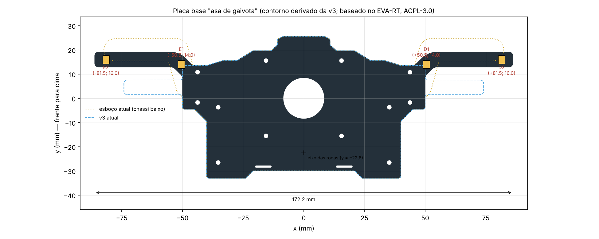

# Chassi "asa de gaivota": posição dos 4 sensores e contorno (11/11/2026)

Continua o [estudo consolidado](../06_estudo_consolidado/README.md) e a [análise do firmware](../07_firmware_e_geometria/README.md). Baseado no EVA-RT, © EXOTIC TEAM MX, [AGPL-3.0](../LICENSE).

Premissas desta etapa (decididas pelo Erick depois dos testes com as abas): chassi asa de gaivota, **dois QRE por lado**, barra a **63–65 mm entre furos** (L ≈ 107–109 mm), frente e traseira da v3 mantidas, abas finas (~6,1 mm) e sensores pouco avançados. A escolha dos pinos fica para a próxima fase.

## Resposta curta

| Sensor | x (mm) | y (mm) |
|---|---:|---:|
| E1 / D1 (internos) | ∓50,5 / +50,5 | 14 |
| E2 / D2 (externos) | ∓81,5 / +81,5 | 16 |

Versão **mínima com asa**, adotada em 11/11 no lugar da primeira (externo em ±82; 20): aba 4 mm mais baixa e 1 mm mais estreita no total, quase com as mesmas margens. Ver [Quão baixa e curta a aba pode ser](#quão-baixa-e-curta-a-aba-pode-ser).

- **Contorno:** [`saida/asa_gaivota_contorno.dxf`](saida/asa_gaivota_contorno.dxf), com 172,2 × 58,6 mm. O corpo (|x| ≤ 50), a frente, a traseira e os 15 recortes (Ø17, 12 furos e 2 rasgos) são os da v3. Mudam só as abas, no estilo das do Fujitora (OPR), com traço geométrico: largura constante de 6,1 mm (como na v3), subida reta a 45° desde o canto dianteiro do corpo (2 mm de subida), dobra de raio 6 mm (linha de centro) e trecho horizontal longo. A ponta é **cópia da ponta da aba da v3** (cantos r 1,45, QRE a 4,6 mm da borda), transladada para o QRE externo. As curvas de concordância com o corpo têm raio 2 mm. A frente da aba fica em y = 19,05, bem atrás do nariz (y = 25,6).
- **Resultado (63,14 mm entre furos):** lê **33/33 marcas no TRIF 2025 e 35/35 no TRIF 2024** em todos os cenários testados: ideal, desvio fixo de ±3 e ±5 mm e "abre na curva" de 10 a 30 mm. No caso ideal, o centro do QRE passa pelo menos **5,5 mm (2025) e 5,9 mm (2024)** dentro da fita na pior marca. Com ±3 mm de desvio, a margem mínima é 3,0 mm; com ±5 mm, 1,1 mm.
- **O que ficou apertado:** o sensor interno passa a **1,9 mm da borda da linha principal** na curva mais fechada do modelo de 2025, no caso ideal. Com 3 mm de desvio, ou num grampo de 180° com R100 (o regulamento permite), ele **passa sobre a linha**. A geometria não resolve isso sem perder marcas: ver [cuidados para o firmware](#cuidados-para-a-próxima-fase-firmware-e-pinos).



## Por que essa posição

A varredura ([`codigo/varrer.py`](codigo/varrer.py)) calculou, para cada posição (x, y) de sensor, a margem de cada marca em 8 cenários (ideal, ±3 e ±5 mm de desvio fixo e "abre" 10/20/30 mm). A conta foi feita em 61, 63,14 e 65 mm entre furos e nas três pistas. Depois, [`codigo/escolher.py`](codigo/escolher.py) combinou um sensor interno com um externo. **Margem** é quanto o centro do QRE entra na fita, medida até a borda mais próxima. Por exemplo, 3 mm de margem significam que o centro passa a pelo menos 3 mm de qualquer borda da fita. Com dois sensores no mesmo lado, vale o melhor dos dois.

O que a varredura mostrou ([tabela completa](dados/escolha.md); TRIF 2024 + 2025, 63,14 e 65 mm):

1. **As marcas pedem dois alcances diferentes.** Com L ≈ 107 mm, o deslocamento lateral do robô ao passar pela marca varia muito. Na saída de curva à esquerda, o corpo está para dentro, e a fita fica perto do corpo: algumas marcas só são lidas com x ≤ ~51 mm. Na saída de curva à direita, acontece o contrário: outras só com x ≥ ~78 mm. Por isso **o interno precisa ficar colado ao corpo (x ≈ 50) e o externo bem para fora (x ≈ 82)**. Com o interno em x = 55, a pior marca já fica fora da fita.
2. **O interno ganha ao avançar um pouco, o externo quase não.** Com o externo em x = 82, mudar o y dele de 14 para 20 não muda quase nada. Já o interno vai de 3,5 mm de margem (y = 8) para 5,1 mm (y = 14) e estabiliza. Por isso o interno ficou em y = 14 (canto do corpo), e não mais à frente.
3. **O y do externo é escolha de forma**, não de leitura: entre 14 e 22 a margem muda menos de 0,6 mm. A primeira versão usou y = 20 (subida maior); a adotada usa y = 16, a menor que ainda deixa a asa, e x = 81,5, o menor alcance sem perder margem. O formato da aba entre os sensores também não altera a leitura, só as posições dos QRE.

**Formato:** a primeira proposta tinha subida de ~17° e ponta com cantos retos, como a v3. A versão atual (pedidos de 11/11) imita a silhueta do Fujitora, com subida curta a 45° e trecho horizontal longo, mas em traço geométrico: largura constante, dobras pequenas e a ponta copiada da v3. A anterior continua no `contorno.py` (`ESTILO = 'suave'`).

Trecho da tabela (feita para a primeira versão), com o externo em (82; 20):

| Interno (x; y) | Margem ideal + abre | Com ±3 mm | Região comum* |
|---|---:|---:|---:|
| (50,5; 8) | 3,5 | 0,7 | −1,5 |
| (50,5; 12) | 4,4 | 1,7 | −0,6 |
| **(50,5; 14)** | **5,1** | **2,3** | **−0,1** |
| (50,5; 20) | 5,0 | 2,8 | 0,0 |
| (52; 20) | 5,4 | 2,8 | 0,7 |
| (55; 14) | 1,7 | −1,1 | −3,6 |

\* "Região comum" é a parte da fita que existe em qualquer pista dentro da tolerância do regulamento (linha 19 ± 1 mm, marca ±3 mm). Margem perto de zero ali significa que, numa pista com a fita 3 mm mais afastada, o centro do QRE passaria rente à borda. O campo de visão do QRE (alguns milímetros) ainda cobre esse caso, mas sem folga.

**Alternativa mais à frente:** interno em (52; 20) e externo em (82; 20), com aba reta em y = 20. Ganha cerca de 0,7 mm na região comum e 1,5 mm de folga até a linha. Em troca, os sensores ficam 6 mm mais à frente, como no esboço original. Não foi a escolhida por causa do pedido de não avançar os sensores.

**Alternativa mais estreita:** externo em x = 80 (largura 169,2 mm). No ideal, a margem cai de 5,1 para 4,0 mm; com ±3 mm, de 2,3 para 1,2 mm.

## Quão baixa e curta a aba pode ser

Mantendo todas as marcas do TRIF 2024 e 2025 em todos os cenários (63,14 mm entre furos), com o interno fixo em (50,5; 14):

| Externo (x; y) | Margem ideal (2025 / 2024) | Com ±3 mm | Com ±5 mm | Com ±5 mm a 65 mm entre furos | Largura | Frente da aba |
|---|---|---:|---:|---:|---:|---:|
| (82; 20), primeira versão | 5,2 / 6,7 | 3,2 | 1,4 | 0,4 | 173,2 | y = 23,05 |
| **(81,5; 16), mínimo com asa (adotada)** | 5,5 / 5,9 | 3,0 | 1,1 | 0,2 | 172,2 | y = 19,05 |
| (81,5; 14), mínimo absoluto (aba reta) | 5,4 / 5,7 | 2,8 | 0,9 | 0,0 | 172,2 | y = 17,05 |

Margens na pior marca das duas pistas, exceto a coluna "ideal". Verificação em passo 0,25 mm, com todos os cenários lendo todas as marcas nas três linhas. A perda vem quase toda do TRIF 2024: baixar e encurtar o externo, juntos, custam ~0,5 mm de margem no pior caso. A 65 mm entre furos, o mínimo absoluto fica sem folga com ±5 mm.

- **Interno:** y = 14 é o mínimo. Em y = 13 a margem com ±5 mm cai para 0,1 mm a 65 mm entre furos; em 12 fica negativa.
- **Externo, altura:** pode descer de 20 para 14 perdendo no máximo 0,6 mm. Abaixo de 14 a aba desceria em direção à ponta, o que não ajuda.
- **Externo, alcance:** x = 81,5 empata com 82; x = 81 zera a margem com ±5 mm; x = 80 perde marcas.

Gerar variantes: `python3 contorno.py --externo 81.5 14 --nome exemplo_minimo_reta`. Comparação em [`saida/comparacao_minimo.png`](saida/comparacao_minimo.png). O mínimo com asa é a versão padrão do `contorno.py` e do simulador. A primeira versão está em `saida/primeira_versao*` (`--externo 82 20 --nome primeira_versao`); a aba reta não está no simulador.

## Resultados (passo 0,25 mm, [`codigo/verificar.py`](codigo/verificar.py))

Pior caso de cada grupo de cenários; "margem" na pior marca. Tabelas completas, marca a marca, em [`dados/tabelas.md`](dados/tabelas.md).

| Configuração | Pista | Ideal | Pior com ±3 mm | Pior com ±5 mm | Pior "abre" 10–30 | Folga int.–linha (ideal / ±3) |
|---|---|---|---|---|---|---|
| **Asa · 63,14 mm** | TRIF 2025 | 33/33 · 5,5 | 33/33 · 3,2 | 33/33 · 1,4 | 33/33 · 5,5 | 1,9 / −1,7 |
| **Asa · 63,14 mm** | TRIF 2024 | 35/35 · 5,9 | 35/35 · 3,0 | 35/35 · 1,1 | 35/35 · 5,8 | 3,5 / −0,3 |
| Asa · 65 mm | TRIF 2025 | 33/33 · 5,1 | 33/33 · 2,3 | 33/33 · 0,4 | 33/33 · 5,4 | 0,7 / −2,9 |
| Asa · 65 mm | TRIF 2024 | 35/35 · 5,0 | 35/35 · 2,1 | 35/35 · 0,2 | 35/35 · 5,6 | 2,1 / −1,8 |
| Primeira versão (82; 20) · 63,14 | TRIF 2025 | 33/33 · 5,2 | 33/33 · 3,2 | 33/33 · 1,4 | 33/33 · 5,3 | 1,9 / −1,7 |
| Primeira versão (82; 20) · 63,14 | TRIF 2024 | 35/35 · 6,7 | 35/35 · 3,7 | 35/35 · 1,8 | 35/35 · 5,5 | 3,5 / −0,3 |
| Esboço (chassi baixo) · 63,14 | TRIF 2025 | 33/33 · 5,4 | 33/33 · 2,7 | 33/33 · 0,8 | 33/33 · 7,6 | 4,8 / 1,2 |
| Esboço (chassi baixo) · 63,14 | TRIF 2024 | 35/35 · 3,1 | 35/35 · 0,2 | **34/35** · −1,7 | 35/35 · 6,3 | 6,5 / 2,7 |
| v3 atual · 63,14 mm | TRIF 2025 | 24/33 | 22/33 | 19/33 | 28/33 | 19,3 / 15,7 |
| v3 atual · 63,14 mm | TRIF 2024 | 20/35 | 21/35 | 22/35 | 23/35 | 20,7 / 16,8 |

- Em relação ao esboço, a asa de gaivota troca um pouco de folga até a linha por margem de leitura. No pior caso das duas pistas, a margem passa de −1,7 para +1,1 mm. O esboço perde uma marca de 2024 com 5 mm de desvio.
- **63 mm é melhor que 65 mm** em tudo, e 61 mm melhor ainda (com ±5 mm, 2,5/2,0 mm de margem; folga ideal até a linha 3,3/5,1 mm). Se a vareta permitir, **o lado curto da faixa de 63–65 mm é o mais seguro**.
- **Pista de teste do EVA-RT** (não regulamentar, com laços e trechos a menos de 200 mm entre si): 25/26 no ideal e 26/26 com "abre" ≥ 10 mm, mas raspando (margem 0,0 mm na pior). A 65 mm entre furos cai para 24–25/26. A marca C12 fica de fora no ideal, como no esboço (25/26) e na v3 (20/26). Como essa pista não é regulamentar, ela não entrou no critério.

### Curvas isoladas: folga dos sensores até a borda da linha (mm)

Interno / externo, pior dos dois lados; negativo = o centro do sensor passa sobre a linha.

| Configuração | R100 90° | R100 180° | R120 180° | R150 90° | R150 180° |
|---|---:|---:|---:|---:|---:|
| Asa · 63,14 mm | 1,5 / 32,4 | −9,5 / 11,2 | −8,6 / 22,0 | 9,9 / 40,8 | 2,4 / 33,2 |
| Esboço · 63,14 mm | 4,4 / 29,4 | −9,4 / 8,6 | −5,3 / 19,3 | 12,6 / 37,8 | 5,5 / 30,3 |
| v3 atual · 63,14 mm | 18,9 | −3,0 | 8,1 | 27,5 | 19,5 |

Em grampos de 180° com raio 100–120 mm, qualquer sensor interno perto do corpo passa sobre a linha com L ≈ 107; até a v3 passa, em R100. O externo nunca encosta.

## Cuidados para a próxima fase (firmware e pinos)

**Pinos:** proposta em [PINOS.md](PINOS.md): E2/D2 em A5/A6 (firmware 1.2.2 sem mudança), E1/D1 em D8/D9 (digital).

1. **Sensores internos podem ver a linha principal em curva fechada.** Isso acontece quando o robô segue a linha com o centro da barra exatamente sobre ela. O robô real tende a abrir na curva, e com 10–30 mm de abertura a folga sobe para 8–22 mm nas pistas do TRIF. Mesmo assim, não dá para contar com isso. O firmware precisa distinguir marca de linha, por exemplo ignorando o interno enquanto a barra indica curva fechada (erro grande), ou exigindo que a marca apareça como um pulso curto.
2. **No lado direito só existem partida e chegada, sempre em reta** (o regulamento exige 250 mm de reta antes e depois da área de partida e chegada). Em reta, qualquer x entre ~55 e ~85 lê a marca. **D2 sozinho já basta para a chegada** e nunca encosta na linha (folga ≥ 11 mm, inclusive no grampo R100). Usar D1 para parar traria de volta o risco de parada falsa em curva fechada à esquerda, que o estudo 07 apontou no EVA-RT. D1 pode servir só para confirmar cruzamentos, ou até ficar sem montar.
3. No lado esquerdo, E1 e E2 são os dois necessários para as marcas de curva. Vale a regra "qualquer um dos dois, contada uma vez".

## Cuidados para o layout no EasyEDA

- O DXF tem só o contorno e o Ø17 na camada `BOARD_OUTLINE`, como o `EVA-RT_contorno_B_degraus.dxf`. Os furos e rasgos vêm do projeto da v3. O [`saida/asa_gaivota_referencia.dxf`](saida/asa_gaivota_referencia.dxf) traz, em camadas separadas, os recortes, a posição e o corpo dos 4 QRE e o contorno da v3, para conferência.
- **E1/D1** ficam na raiz da aba, no canto dianteiro do corpo. O QRE fica embaixo; a presilha da vareta, em cima, com furo em (±43,75; 10,75). Manter componentes de cima e porcas fora do espaço da presilha, que tem 9,5 × 7 mm no STL e orientação a conferir no 3D.
- **E2/D2** ficam no trecho horizontal (6,1 mm de largura, de x ≈ 58 até a ponta, que é a mesma da v3), com espaço para o 220 Ω, o 47 kΩ, o 1 kΩ e o LED, como na v3 (x ≈ 72–86). A ponta vai até x = 86,1.
- As abas ficam em y ≥ ~7 na raiz, longe das rodas e da gearbox, que estão em y < −4,5. Mesmo assim, conferir no 3D com os STL antes do Gerber.
- A aba tem cerca de 36 mm em balanço, contra 24 mm na v3. Em FR-4 de 1,6 mm deve aguentar, mas vale evitar furos e vias grandes na raiz.

## Limites

- As pistas são modelos aproximados (fotos, rascunho e um quadro de vídeo), não plantas oficiais. A trajetória no cruzamento é imposta.
- A análise é só geométrica: centro do QRE × retângulo da fita. Não modela óptica, altura, PID, motor, derrapagem nem tempo. "Desvio fixo" e "abre na curva" são hipóteses de comportamento, não medidas do robô.
- O contorno não foi roteado nem conferido em 3D com os STL. Os QRE estão desenhados com o corpo do footprint da v3 (2,7 × 3,4 mm).
- A medida de 63,14 mm foi tratada como distância do furo da frente da base (y = 10,75) ao furo da barra (L = distância + 43,97). O estudo 07 encontrou L = 100 mm na camada Document do `EVA_RT.eprj`. Se a medida foi feita a partir do furo de trás, L fica mais curto, e todas as margens daqui melhoram.

## Arquivos

| Arquivo | Conteúdo |
|---|---|
| `saida/asa_gaivota_contorno.dxf` | contorno para importar (BOARD_OUTLINE: contorno + Ø17), mm, R2000 |
| `saida/asa_gaivota_referencia.dxf` | idem + recortes da v3, QRE e contorno da v3 em camadas separadas |
| `saida/asa_gaivota.png` | figura acima |
| `saida/contorno.json` | medidas, sensores e pontos do contorno (usado pelo simulador) |
| `codigo/geometria_v3.py` | lê o contorno e os recortes do `.epro` da v3 |
| `codigo/contorno.py` | gera o contorno (parâmetros no topo do arquivo) |
| `codigo/margens.py` | margem marca × posição do sensor, desvio fixo, folga até a linha |
| `codigo/varrer.py` · `codigo/escolher.py` | varredura (gera `dados/grade_margens.npz`, ~45 MB, fora do git) e tabela da escolha |
| `codigo/verificar.py` | verificação final em passo 0,25 mm → `dados/resultados.json`, `dados/tabelas.md` |

No [simulador](../06_estudo_consolidado/simulador.html), a configuração **Asa de gaivota · 2 sensores por lado** (agora a inicial) mostra o novo contorno nas três pistas. O teste `06_estudo_consolidado/codigo/verificar_duas_pistas.js` confere as contagens do simulador com as do `verificar.py`.

Reprodução, a partir de `codigo/` (usa as pistas de `../06_estudo_consolidado/codigo` e a cinemática de `../07_firmware_e_geometria/codigo`):

```sh
python3 -m pip install numpy scipy shapely matplotlib ezdxf
python3 contorno.py      # DXF, PNG e JSON (segundos)
python3 verificar.py     # resultados e tabelas (~15 min)
python3 varrer.py        # grade de margens (~6 min)
python3 escolher.py      # tabela da escolha (~1 min)
```
