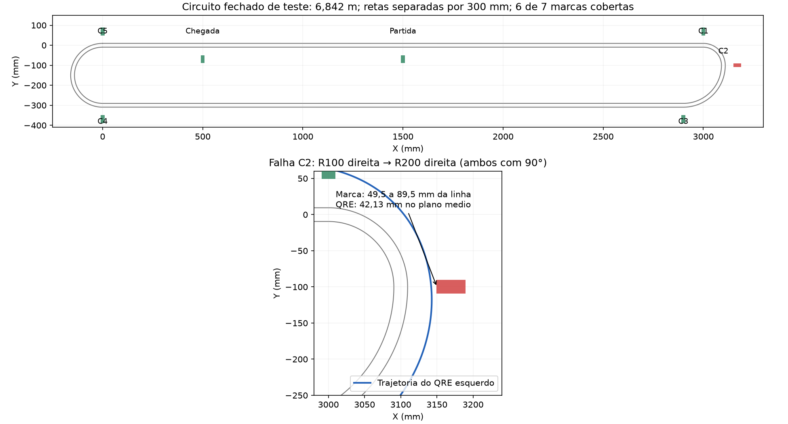

# Estudo de caso - viabilidade do seguidor de linha

Registro do estudo realizado em 09/11/2026 sobre a leitura das marcações laterais do **RUSH / SATURN v3**, baseado no EVA-RT, para a **7ª edição do TRIF 2026**. O objetivo é apoiar a decisão sobre a PCB a encomendar, preservando o contexto e as correções da análise.

**Situação ao encerrar este registro:** a configuração com vão de aproximadamente 26,9 mm e sensores avançados 1 mm passou pelas 19 marcas nominais da primeira volta, mas perdeu uma das sete marcas de um segundo circuito fechado. Isso demonstra uma limitação da trajetória cinemática testada; não demonstra impossibilidade de funcionamento com outro controle. A configuração ainda não está validada como solução garantida de leitura para fabricação.

## 1. O que o usuário precisa preservar

- Uma única PCB principal, com os sensores de marca integrados.
- Um QRE por lado, sem sensores externos ou módulos adicionais.
- Abas laterais do mesmo tamanho e sensores em posições espelhadas.
- Distância base–barra igual à do EVA-RT, admitindo uma alteração pequena.
- Rodas, motores e peças impressas tomando o EVA-RT como referência de montagem.
- Nesta etapa, analisar a viabilidade; não implementar firmware.

As hipóteses de vários sensores por lado, módulos externos e grande redução do vão foram discutidas durante a investigação, mas **não atendem ao conjunto final de restrições**. Posições alternativas de soldagem foram apenas uma proposta; não foram adotadas nem aplicadas ao CAD.

## 2. Arquivo atual do robô

O arquivo recebido está preservado em [01_projeto/](01_projeto/), com seu nome original:

`ProPrj_RUSH - SATURN - v3_2026-11-09.epro`

- SHA-256: `ecc0495a237022ebb8a2ca117a50deeefd051657176f5c42b0f6bf40fd09cb57`.
- Tamanho: 228.991 bytes.
- É uma cópia byte a byte do arquivo fornecido, sem aplicar os deslocamentos estudados.
- Os sensores desse arquivo estão aproximadamente em **(x = ±69,5 mm; y = 4,5 mm)**, na face inferior.
- A configuração ajustada usa **y = 5,5 mm somente na simulação**. Não há nesta pasta um `.epro` modificado ou um Gerber de fabricação aprovado.

O referencial da PCB tem origem no centro da ventoinha, +y para a frente e +x para a direita. S1 é o sensor esquerdo de curvas; S2 é o direito de partida/chegada. Não confundir as referências S0/S1 de esquemáticos históricos com as referências S1/S2 deste arquivo recebido.

## 3. Distância da base à barra não é L

Neste estudo, **vão** é a distância longitudinal entre a borda frontal central da base e o recorte traseiro central da barra V1. **L** é a distância entre o eixo das rodas e o ponto virtual central de seguimento da barra. Não são a mesma cota.

| Medida | Montagem de referência | Ajuste estudado |
|---|---:|---:|
| Vão base–barra | 34,8885 mm | 26,8885 mm |
| L, eixo até ponto central da barra | 92,7955 mm | 84,7955 mm |
| Sensor lateral, x | ±69,5 mm | ±69,5 mm |
| Sensor lateral, y na PCB | 4,5 mm | 5,5 mm |
| Eixo das rodas, y na PCB | −22,5877 mm | −22,5877 mm |

O ajuste corresponde a aproximar a barra 8 mm da base e avançar os dois QRE 1 mm, sem deslocar rodas ou motores. Preserva um sensor por lado e a simetria. A viabilidade do pequeno deslocamento dos QRE foi examinada em 2D; a montagem completa não foi validada em CAD 3D.

A estimativa do vão do EVA-RT veio do desenho de referência. Aplicar esse vão à base SATURN e à barra V1 resulta em L ≈ 92,8 mm. Os valores históricos de L = 67–70 mm descrevem uma montagem mais compacta; aproximadamente 100 mm descreviam outra referência do desenho original. Esses valores não podem ser usados como se fossem a mesma montagem.

## 4. Simulações principais

| Configuração | Circuito | Cobertura nominal | Região comum às tolerâncias consideradas |
|---|---|---:|---:|
| Vão 34,9 mm; sensores originais | Volta revisada de 19 marcas | **17/19** | 14/19 |
| Vão 26,9 mm; QRE avançados 1 mm | Mesma volta revisada | **19/19** | 17/19 |
| Vão 26,9 mm; QRE avançados 1 mm | Circuito fechado R100 → R200 | **6/7** | 6/7 |

### Como assistir

As animações estão em [03_simulacoes/02_ajuste_8mm_1mm/](03_simulacoes/02_ajuste_8mm_1mm/):

- [Volta 19/19](03_simulacoes/02_ajuste_8mm_1mm/volta_19_de_19.html).
- [Circuito 6/7](03_simulacoes/02_ajuste_8mm_1mm/circuito_6_de_7.html).

O GitHub mostra o código dos arquivos HTML. Baixe os arquivos, ou baixe o repositório, e abra-os em um navegador para executar a animação. Eles contêm os dados e funcionam como arquivos locais. Use **Simular volta**, **Próxima marca** ou a seleção de marca; o circuito 6/7 abre ampliado em C2. A animação não representa velocidade ou tempo físico de volta.

### Volta revisada: 19/19 não significa centralização

A volta tem aproximadamente 10,785 m de circuito geométrico e 19 marcas: 17 de mudança de curvatura, partida e chegada. Foi revisada para eliminar uma sobreposição entre duas marcações de uma versão anterior, mantendo outras curvas R100 no trajeto.

Com o ajuste de 8 mm / 1 mm, as 19 trajetórias intersectam as fitas nominais. Há, porém, passagens próximas das bordas. Na marca M7, o afastamento no plano médio é aproximadamente **89,4953 mm**, perto da borda externa nominal de 89,5 mm. Em M11, o sensor intersecta uma parte da fita fora do plano médio. Não é correto transformar a contagem 19/19 em prova de margem óptica, centralização ou leitura ADC.

### Segundo circuito: falha C2 em R100 → R200

O segundo ensaio é um circuito fechado sem cruzamentos, com 6,842 m. Um retorno combina R100 à direita de 90° com R200 à direita de 90°; o outro usa R150 de 180°. Arcos consecutivos de diferentes curvaturas são previstos no item 4.16 do regulamento consultado.

Foram conferidos raio mínimo de 100 mm, retas paralelas a 300 mm entre centros (281 mm entre bordas), separação entre extremidades opostas, marcações a 40 mm da borda da linha, ausência de sobreposição de marcas, chegada 1 m antes da partida e as retas da área de partida/chegada. A manta de referência tem margem superior a 200 mm; portões opcionais não foram modelados. Os arcos conectados da mesma curva composta são tratados como vizinhos, e não como trechos independentes para a medição de afastamentos.

**C2 não foi coberta.** O afastamento do QRE no plano médio foi aproximadamente **42,1271 mm**, enquanto a borda interna nominal da marca fica a 49,5 mm. A ausência de interseção foi conferida contra o retângulo inteiro, e não apenas nesse plano. A classificação das sete marcas foi verificada por um segundo método usando Shapely.

## 5. Correção importante: os 220 ensaios exploratórios

Foram geradas 220 situações locais combinando reta e raios de 100, 150, 200, 300 e 500 mm para ambos os lados: 11 tipos, 110 pares ordenados diferentes e duas aproximações por arcos de 90° e 180°. Quando a aproximação é reta, o ângulo não se aplica e as duas variantes produzem a mesma geometria; portanto a contagem também inclui duplicatas. Os raios foram escolhidos para a exploração; o regulamento não enumera essas 220 situações nem exige que todas sejam ensaiadas.

**O conjunto não havia sido validado integralmente contra o edital.** Uma auditoria posterior identificou **20 sequências com cruzamentos incompatíveis** com a exigência de 250 mm retos antes e depois de um cruzamento. Exemplo: reta → R100 de 180° → R150 de 90° → reta pode cruzar a primeira reta apenas 50 mm após sair da curva.

Os outros 200 casos apenas não foram reprovados por essa verificação específica; não são 200 pistas integralmente aprovadas. Uma sequência desenhada de modo inválido também não torna sua transição local proibida: a transição pode ser inserida em outro circuito conforme.

Por isso, os índices globais sobre **220** foram **retirados como critério de aprovação ou reprovação da montagem para o TRIF**. Os dados foram preservados em [04_historico_exploratorio/](04_historico_exploratorio/) para rastreabilidade, não para fundamentar a encomenda. A falha C2 do circuito fechado de sete marcas foi construída e conferida separadamente desse conjunto.

## 6. Modelo e significado dos resultados

- Corpo rígido, eixo das rodas sem escorregamento lateral.
- Ponto virtual central da barra exatamente sobre o centro da linha.
- Orientação integrada por `dα/ds = sen(φ − α) / L`.
- QRE representado pelo centro do encapsulamento; janelas ópticas, altura e área efetiva não modeladas.
- Sem resposta dos motores, aderência, bateria, dinâmica da ventoinha ou controle PD real.
- **Cobertura nominal:** caminho do ponto do QRE intersecta o retângulo branco de 40 × 19 mm, entre 49,5 e 89,5 mm do centro da linha.
- **Região comum às tolerâncias consideradas:** intervalo transversal de 53 a 83 mm e longitudinal de ±9 mm. É um teste conservador de cobertura, não uma avaliação completa de todas as tolerâncias físicas. Falhar nele não equivale a falhar para todas as combinações de tolerâncias possíveis.
- **Centro da marca:** critério analítico separado; o edital não exige passagem pelo centro da fita.

Uma falha mostra que **essa geometria com essa trajetória** perdeu a marca. Não prova que qualquer controlador necessariamente falhará. Alterar a trajetória pode melhorar a cobertura, mas isso não foi demonstrado. Apenas reduzir a velocidade, sem mudar o caminho no modelo geométrico, não muda as interseções. Calibração e temporização podem ajudar sinais existentes, mas não criam uma observação de uma marca que não passou pelo campo de leitura.

## 7. Conclusão atual e pendências

É possível manter fisicamente uma PCB, um sensor por lado e abas simétricas. **Não foi demonstrado que perder marcas seja inevitável para toda pequena alteração**, nem foi demonstrado que o firmware elimine as falhas. Também não existe base para afirmar que o robô sempre perderá exatamente uma ou duas marcas.

Antes de considerar a leitura resolvida para fabricação, faltam: avaliar uma trajetória/controlador que cubra os casos críticos dentro das restrições, conferir montagem 3D e patim da V1, medir pneu externo e altura real dos QRE, e validar o sinal em fita/piso representativos. O STL de roda descreve o aro, não o diâmetro externo do pneu montado.

Não foi implementado firmware nem aplicada uma nova posição ao projeto eletrônico. Este arquivo é um registro de estudo e de evidências; não é uma aprovação da PCB, do circuito elétrico completo ou da participação no evento.

## 8. Arquivos, fontes e reprodução

| Pasta/arquivo | Conteúdo |
|---|---|
| `01_projeto/` | Arquivo `.epro` recebido, preservado |
| `02_referencias/` | Regulamento consultado, Gerber da V1, STL relevantes, parâmetros e medidas |
| `03_simulacoes/01_base_original/` | Volta revisada com vão original estimado; resultados 17/19 |
| `03_simulacoes/02_ajuste_8mm_1mm/` | Animações 19/19 e 6/7, dados, figuras e conferência |
| `04_historico_exploratorio/` | Resultados exploratórios e imagem antiga de 432 passagens, com ressalvas |
| `05_codigo/` | Núcleo de cálculo arquivado e reprodução portátil dos ensaios principais/auditoria |
| `MANIFESTO_SHA256.json` | Tamanhos e hashes dos arquivos do pacote, exceto o próprio manifesto |

Consulte [REPRODUCAO.md](REPRODUCAO.md) para executar os cálculos. Os HTML podem ser usados sem instalar Python.

Regulamento: [cópia consultada da 7ª edição TRIF 2026](02_referencias/TRIF%202026%20-%20Seguidor%20de%20Linha.pdf), que aplica a classe Pro do anexo RoboCore de 03/09/2024; [página oficial do evento](https://www.ifsp.edu.br/index.php/trif/83-pesquisa/6044-trif2026). A cópia local foi a fonte de leitura; não se afirma que seu conteúdo tenha sido comparado byte a byte com a cópia remota do Drive.

Projeto de referência: [EXOTIC-TEAM-MX/EVA-RT](https://github.com/EXOTIC-TEAM-MX/EVA-RT), © EXOTIC TEAM MX, AGPL-3.0. A cópia local de referência foi identificada no repositório como commit `d630829`. Crédito e licença do projeto de origem são preservados em [02_referencias/EVA_RT_CREDITOS.md](02_referencias/EVA_RT_CREDITOS.md) e [LICENSE](LICENSE). O regulamento e demais materiais de terceiros conservam sua autoria; a inclusão no estudo não lhes atribui a licença do código.
