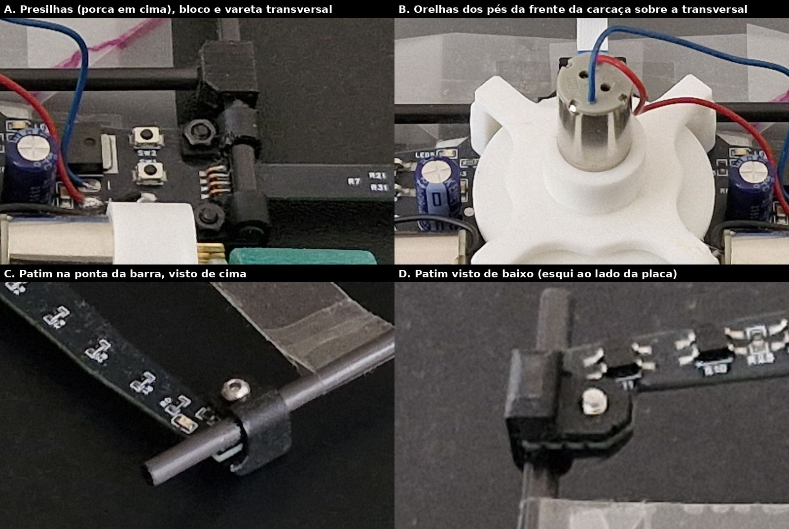
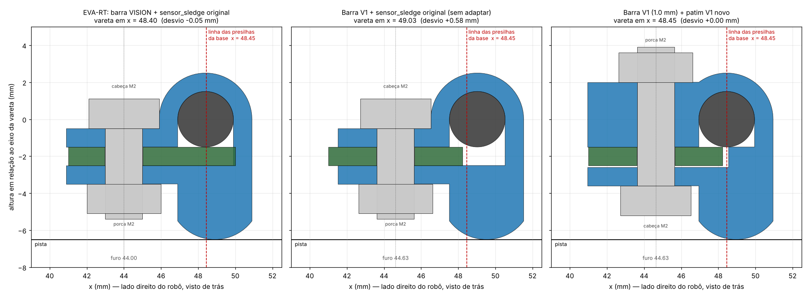
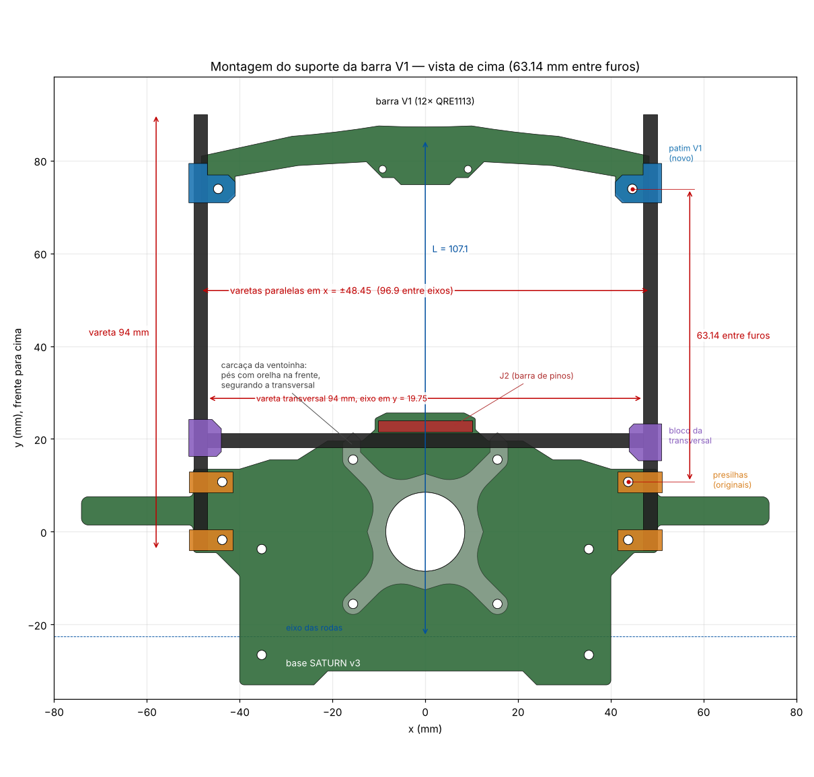
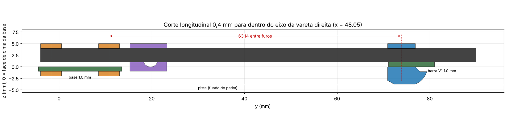

# Suporte da barra V1 na base SATURN v3 (16/11/2026)

_Origem = centro da ventoinha, +y = frente, z = 0 na face de cima da base, mm. Peças e medidas originais: EVA-RT, © EXOTIC TEAM MX, AGPL-3.0._

Fontes conferidas: `ProPrj_RUSH - SATURN - v3_2026-11-09.epro` (placa final), `hardware/barra_v1/` (Gerber da V1), `referencias/eva-rt/` (STL, Gerber e camada Document) e as fotos do repositório do EVA-RT (commit `d630829`).

## Como o EVA-RT prende a barra

- **Três varetas de carbono Ø3 × 94 mm**: duas longitudinais (de y = −4 a y = 90) e uma transversal.
- **`barilla_clamp` (4×):** rasgo de 1,0 mm que abraça a borda da base em x = ±50; a vareta entra num canal em U por cima. O parafuso M2 atravessa braço de baixo, placa e braço de cima (porca em cima). O parafuso fica a 4,70 mm do eixo da vareta → vareta em **x = ±48,45**, eixo 2,5 mm acima da base.
- **`sensor_sledge` (2×):** mesma ideia na ponta da barra, com o esqui que apoia na pista. A vareta apoia em cima da barra e o parafuso fica a 4,40 mm dela. Com os furos da VISION em x = ±44,00 a vareta sai em x = ±48,40: **paralela à das presilhas (0,05 mm de diferença)**. É assim que o EVA-RT fica "em linha reta".
- **`barilla_connection` (2×):** não liga a vareta à barra. É o bloco que une cada vareta longitudinal à **vareta transversal**, que passa deitada sobre a base (eixo em y ≈ 19,75, z = 1,5) e fica presa **sob as orelhas dos dois pés da frente** da carcaça da ventoinha (foto B).
- **Distância:** nada trava a posição ao longo da vareta. Presilhas e patim seguram por aperto, então a barra desliza para frente e para trás. No desenho do EVA-RT os furos correspondentes ficam a **56,15 mm** (L = 100,0 mm).

## O que muda com a SATURN v3 e a V1
| Item | EVA-RT | Este robô | Consequência |
|---|---|---|---|
| Furos das presilhas na base | (±43,75; −1,75 e 10,75), Ø2,0 | iguais | `barilla_clamp` serve como está |
| Borda da base nas presilhas | x = ±50, y de −4 a 13 | igual; o braço de marca sai entre as duas (y 0,45…8,55) | serve; sem componentes nem vias embaixo |
| Furos da barra | ±44,00 (VISION) | **±44,626** (V1), Ø2,05 | com o patim original a vareta iria para x = ±49,03: **0,58 mm aberta de cada lado** |
| Borda lateral da barra | x = ±50,0 | **x = ±48,25** | a V1 acaba 0,2 mm antes do eixo da vareta: no patim original a vareta fica sem apoio |
| Furos da carcaça, motores, Ø17 | — | iguais | demais STL servem |

## Patim novo (`mecânica/stl/patim_v1_*.stl`)

Mantém o esqui, o canal da vareta, o furo Ø2,0 e a orientação de impressão do original. Mudanças:
1. **Parafuso a 3,824 mm do eixo da vareta** (era 4,40): 48,45 − 44,626. As varetas ficam paralelas, na mesma linha das presilhas.
2. **Assento sob a vareta** onde a V1 não chega (ela acaba em x = 48,25; folga de 0,3 mm até o assento).
3. **Bloco de cima com topo plano** 2 mm acima do eixo da vareta. Com o parafuso mais perto, a porca M2 bateria no ressalto redondo do original.
4. Rasgo com 0,1 mm de folga sobre a espessura da barra.
5. Versões **direita e esquerda** (espelhadas), para a ponta do esqui apontar para a frente dos dois lados. O EVA-RT publica só um lado.

O gerador reconstrói antes as duas peças originais com os mesmos parâmetros e compara com os STL do EVA-RT (diferença menor que 0,1 mm³ em peças de 112 e 224 mm³), para garantir que as medidas lidas estão certas.

## Montagem a 63,14 mm entre furos

- Furo da barra em y = 73,89; origem da V1 em y = 77,575; **L = 107,1 mm** (eixo das rodas → sensores centrais). No EVA-RT: 56,15 mm e L = 100.
- **Dá para aumentar e diminuir:** é só deslizar o patim na vareta. Com varetas de 94 mm (a ponta fica 2,5 mm à frente da V1) vai até ~73 mm entre furos; cada milímetro a mais de vareta dá um a mais. Para menos, o limite é a barra encostar no bloco da transversal (~20 mm).
- Para acertar a cota com paquímetro: **57,89 mm** entre a face da frente da presilha dianteira e a face de trás do patim.
- Alturas com a vareta nivelada: barra 1,0 mm acima da base; face de baixo da barra a **4,0 mm da pista** (QRE a ~2,3 mm), igual ao EVA-RT. A vareta fica nivelada com pneu de Ø ≈ 22 mm (eixo 7,0 mm acima da base).

Conferência 3D (`ferramentas/pecas_3d/conferir_montagem.py`): nenhuma interferência do patim com a barra, a vareta ou o parafuso; nenhum pad da V1 sob os braços do patim. As presilhas originais entram 0,05 mm na borda da base, como no próprio EVA-RT.

## Pontos de atenção
- **Espessura da base: pedir 1,0 mm.** O empilhamento do `.epro` está no padrão do EasyEDA (1,6 mm) e o rasgo do `barilla_clamp` é de 1,0 mm. Se a base vier com 1,6 mm, usar `mecânica/stl/se_a_placa_tiver_1.6mm/presilha_vareta_pcb1.6.stl`.
- **Espessura da V1: medir.** O Gerber não informa. Há patim para 1,0 e para 1,6 mm. Com 1,6 mm a barra fica a 3,4 mm da pista e a cabeça do parafuso a ~0,7 mm: usar cabeça baixa.
- **Vareta transversal × J2:** a transversal passa a **0,23 mm** do corpo da barra de pinos J2 (y = 22,74). Cabe, mas a J2 tem de ser soldada bem alinhada.
- **Carcaça da ventoinha:** montar com os dois pés de orelha para a frente.
- **Carbono conduz.** A transversal deita sobre a máscara de solda da base (uma trilha de +5V passa embaixo, sem via nem pad exposto).
- O pneu e a altura real dos QRE continuam sem medida (ver o estudo de caso).

## Impressão, ferragens e ordem de montagem
Em [`mecânica/README.md`](../mecânica/README.md): lista de STL com quantidades, material, parafusos, varetas e passo a passo.
