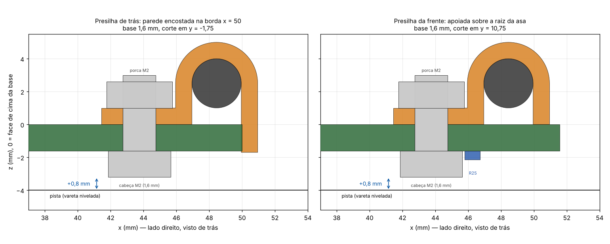
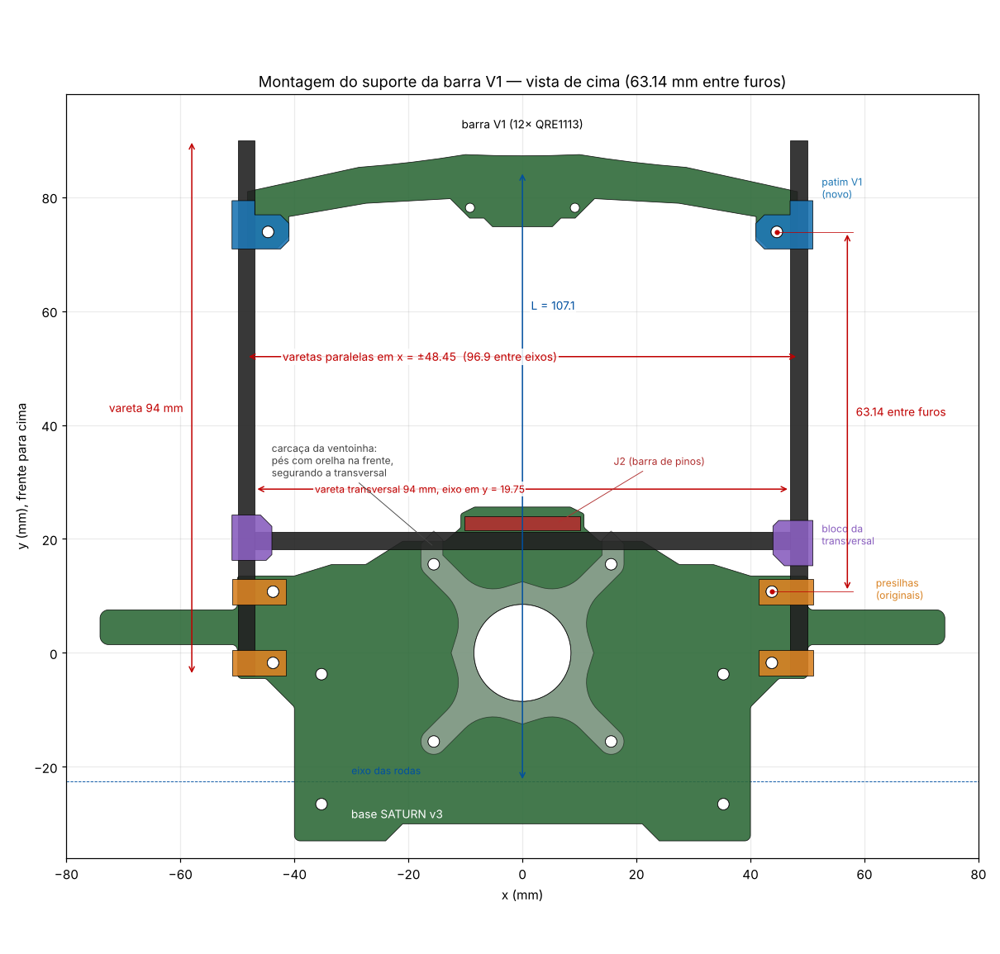
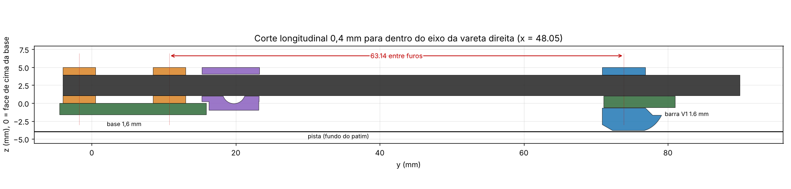

# Mecânica — peças para imprimir e montar

Peças do EVA-RT (© EXOTIC TEAM MX, AGPL-3.0) adaptadas à placa encomendada, **RUSH - SATURN v12** (asa de gaivota), com a **base de 1,6 mm** e a **barra V1 de 1,6 mm**, para imprimir em **PLA e PETG**.

| Seção | O que tem |
|---|---|
| [O que imprimir](#o-que-imprimir) | STL separados por filamento (`stl/PETG/` e `stl/PLA/`), quantidades e configuração |
| [Primeira impressão: ventoinha e motores](#primeira-impressão-ventoinha-e-motores) | ordem para imprimir e testar as peças dos motores antes de a placa chegar |
| [Ferragens](#ferragens) | varetas, parafusos, porcas, rolamentos e cola |
| [Ordem de montagem](#ordem-de-montagem) | passo a passo |
| [Cuidados](#cuidados) | o que pode dar errado na montagem e na pista |
| [Por que as peças mudaram](#por-que-as-peças-mudaram) | base de 1,6 mm, asa de gaivota e PLA/PETG |
| [Conferência 3D](#conferência-3d) | folgas e altura de cada peça até a pista |

A análise do suporte da barra está em [`SUPORTE_BARRA_V1.md`](SUPORTE_BARRA_V1.md). Os STL são gerados por `ferramentas/pecas_3d/gerar_pecas.py`. Os do EVA-RT são cópias de `referencias/eva-rt/3d_models/`; a carcaça e as caixas de redução só foram giradas para a posição de impressão.

## O que imprimir
Imprima uma pasta inteira de cada vez. O motivo de cada filamento está em "Por que as peças mudaram".

**`stl/PETG/`** (peças sob aperto de parafuso ou perto de motor):

| Arquivo | Qtde | Função |
|---|---|---|
| `presilha_vareta_tras_base1.6.stl` | 2 | presilha de trás (y = −1,75), parede na borda da base |
| `presilha_vareta_frente_asa.stl` | 2 | presilha da frente (y = 10,75), apoiada sobre a raiz da asa |
| `patim_v1_direito_barra1.6.stl` | 1 (+1 de reserva) | patim da barra V1, lado direito (+x) |
| `patim_v1_esquerdo_barra1.6.stl` | 1 (+1 de reserva) | patim da barra V1, lado esquerdo |
| `bloco_transversal_asa.stl` | 2 | une a vareta longitudinal à transversal |
| `placa_succao_rebaixo.stl` | 1 | placa de sucção de 0,6 mm, com rebaixo para a cabeça do parafuso nos 4 pés |
| `gearbox.stl` | 1 | caixa de redução **direita** (pinhão para fora) |
| `gearbox_esquerdo_espelhado.stl` | 1 | caixa de redução esquerda (o EVA-RT publica só um lado) |
| `impeller_base_1.stl` | 1 | carcaça da ventoinha (4 pés) |
| `impeller_base_2.stl` | 1 | parte de cima da carcaça, segura o motor |
| `impeller_fan.stl` | 1 | hélice |

**`stl/PLA/`**:

| Arquivo | Qtde | Função |
|---|---|---|
| `wheel_rim.stl` | 2 | aro da roda (rolamentos 692ZZ); o PLA acerta melhor a medida do alojamento |
| `battery_holder.stl` | 1–2 | apoio da bateria na vareta de trás (a foto mostra um); serve PETG também |
| `bead.stl` | ? | bucha Ø6 / Ø3,15 com furo Ø2,15 (ver "Não conferido"); serve PETG também |
| `gabarito_base_teste.stl` | 1 | **só para testes**: base de 1,6 mm com o contorno e os furos da placa (asas cortadas), para montar a ventoinha e as caixas antes de a placa chegar |

Origem: presilhas, patins, bloco e placa de sucção são adaptações; o resto é do EVA-RT como está. Do EVA-RT, não entram: `sensor_sledge.stl` (barra VISION), `barilla_clamp.stl` (rasgo de 1,0 mm), `suction_base.stl` e `barilla_connection.stl` (substituídas pelas adaptadas).

### Configuração de impressão
- **Todos os STL já estão na posição de impressão. Nenhum precisa de suporte:** é só abrir no fatiador e imprimir, sem girar.
  - A carcaça (`impeller_base_1`) vai de cabeça para baixo: o topo é plano. Apoiada nos pés, teria ~490 mm² em balanço.
  - As caixas de redução vão deitadas sobre a face do pinhão. Os furos do motor (Ø10,18) e do eixo (Ø2,0) ficam na vertical: saem redondos, e o aperto do motor fica no plano das camadas, onde a peça é mais forte.
  - A placa de sucção vai com os rebaixos para cima: o fundo de 0,2 mm sai na primeira camada.
  - A hélice tem 6 corpos no STL (disco + 5 pás). O fatiador junta.
  - O aro tem um degrau interno (do furo de Ø11 para o alojamento de Ø6,2 do rolamento) e uma aba de 1,75 mm no topo. Imprime sem suporte, mas a borda de baixo do alojamento pode cair um pouco: conferir o rolamento.
  - Patim, presilhas e bloco têm o furo da vareta na vertical. O assento das presilhas e o rebaixo do bloco também saem sem suporte.
- Bico de 0,4 mm, camada de 0,12–0,16 mm, 3 perímetros ou mais, 100% de preenchimento.
- PETG:
  - filamento seco e retração bem ajustada: fio solto desbalanceia a hélice e fecha o furo da vareta;
  - em PEI liso, passar cola bastão como separador, porque o PETG gruda demais e arranca a superfície;
  - ventilador da peça em 30–50%, parede externa devagar (~20–25 mm/s) e tempo mínimo por camada de ~10 s. Como as peças são pequenas, imprimir várias juntas também dá tempo de esfriar;
  - temperatura do bico e da mesa: as do fabricante do filamento.
- Placa de sucção: 3 camadas de 0,2 mm.
- Os furos de Ø2,0 e de Ø3,0 da vareta saem justos de propósito, como no original. Se a vareta não entrar, passar broca de 2 mm ou de 3 mm à mão. Como o furo das presilhas agora é fechado, a vareta tem de atravessar as duas presilhas e o bloco: alargar o furo só o bastante para ela deslizar com atrito.
- Hélice: conferir se gira sem bater antes de dar potência. Se vibrar, imprimir de novo.
- Imprimir primeiro **uma** presilha de cada tipo e **um** patim e testar na placa, na barra e com a vareta antes do resto.
- O fundo do esqui desgasta na pista: imprimir um par de reserva.

## Primeira impressão: ventoinha e motores
Vale começar por elas. São as peças com os encaixes mais críticos (motor Ø10,18, eixo Ø2,0, rolamento Ø6,19, cubo da hélice). Imprimindo antes, um problema de medida aparece cedo, e dá para filmar a ventoinha e as caixas funcionando sem a placa, montadas no `gabarito_base_teste.stl`.

**Ordem das mesas.** Dá para imprimir tudo antes de a placa chegar. Cada mesa junta peças do mesmo filamento, e as peças pequenas juntas ajudam o PETG a esfriar entre camadas. A primeira mesa é de teste: só siga depois de conferir as medidas dela.

| Mesa | Filamento | Peças | Conferir antes de seguir |
|---|---|---|---|
| 1. Teste de medidas | PETG | `gearbox.stl`, `impeller_base_2.stl`, 1 `presilha_vareta_tras_base1.6.stl`, 1 `patim_v1_direito_barra1.6.stl` | motor 1020 firme nas duas peças, sem trincar; eixo de Ø2 passando; M2 passando; vareta de Ø3 na presilha e no patim; patim na ponta da barra V1. Se algum furo sair fora, ajustar a compensação de furos (*hole/XY compensation*) do fatiador antes da mesa 3 |
| 2. Base de teste | PLA | `gabarito_base_teste.stl`, 1 `wheel_rim.stl` | M2 passando nos furos do gabarito; rolamento 692ZZ firme no aro |
| 3. Ventoinha | PETG | `impeller_base_1.stl`, `placa_succao_rebaixo.stl`, `impeller_fan.stl` (só com o cubo resolvido, ver abaixo) | montar no gabarito e fazer o teste da ventoinha |
| 4. Resto do PETG | PETG | `gearbox_esquerdo_espelhado.stl`, 1 `presilha_vareta_tras_base1.6.stl`, 2 `presilha_vareta_frente_asa.stl`, `patim_v1_esquerdo_barra1.6.stl`, 2 `bloco_transversal_asa.stl` | montar varetas, presilhas, blocos, patins e barra V1 no gabarito: barra paralela e 63,14 mm entre furos |
| 5. Resto do PLA | PLA | 1 `wheel_rim.stl`, `battery_holder.stl`, `bead.stl` | — |
| 6. Reservas | PETG | 1 `impeller_fan.stl`, 1 par de patins | — |

**Montagem no gabarito:**
- A frente do gabarito é o lado da aba da J2.
- Carcaça com os dois pés de orelha para a frente. Por baixo, a placa de sucção com os rebaixos virados para fora, presa com 4× M2 × 6 que fazem rosca direto nos pés.
- Caixas de redução: M2 × 6 e porca, como na placa.
- O gabarito tem a mesma espessura da placa (1,6 mm), então os comprimentos de parafuso são os mesmos. Os furos dele são de Ø2,2, para o M2 passar sem broca.

**Cubo da hélice (resolver antes de imprimir):**
- O furo do cubo tem Ø3,4 e atravessa o cubo todo (4 mm), mas o eixo do 1020 tem 1,2 mm. O EVA-RT não documenta o que vai no meio.
- Pela medida, o mais provável é um **pinhão 11T M0,3 prensado no eixo da ventoinha** (furo de 1,15 mm, como nos motores das rodas). O pinhão é então cravado no cubo, com os dentes (Ø3,9) mordendo o plástico, mais uma gota de cola.
- Confira se sobrou um pinhão para o terceiro motor.
- Não use a hélice solta no eixo, nem com cola só no eixo de 1,2 mm.

**Teste da ventoinha:**
- Fonte de bancada com limite de corrente, começando em ~3 V e subindo até 7,4 V. Sem a placa, o motor recebe tensão cheia, sem PWM.
- Use óculos de proteção: a ~50 mil rpm, uma pá que se solta vira projétil.
- Conferir se a hélice gira sem raspar e sem vibrar.
- Conferir o sentido: um papel encostado no furo de Ø17, por baixo, tem de ser puxado. Se for soprado, inverta os fios.
- **Para o vídeo da sucção:** apoie o conjunto sobre a manta ou uma superfície lisa e mostre que ele gruda. Para medir, puxe-o para cima com uma balança de mão ou um dinamômetro.
- Pôr o conjunto em cima de uma balança de cozinha não mede nada: a força fica entre o conjunto e o prato.

**Teste das caixas:**
- Precisa do pinhão prensado no motor (na morsa, sem martelo), da engrenagem de 64 dentes, do eixo de Ø2 e do aro com os rolamentos e o pneu.
- Enquanto faltar alguma dessas peças, dá para filmar o motor girando preso na caixa.
- Com tudo, ligue o motor direto na fonte para ver o engrenamento. O EVA-RT dá 0,07 mm de folga entre os dentes, então o engrenamento deve rodar macio.

## Ferragens
| Item | Qtde | Onde |
|---|---|---|
| Vareta de carbono Ø3 mm × 94 mm | 3 | 2 longitudinais + 1 transversal (o EVA-RT usa tubo) |
| Vareta de carbono Ø3 mm × ~80 mm | 1 | traseira, entre as caixas de redução (comprimento estimado, medir na montagem) |
| Parafuso M2 × 6 + porca M2 | 4 | presilhas: cabeça por baixo da base, porca em cima do braço (base 1,6 + braço 1,0 + porca 1,6 = 4,2 mm) |
| Parafuso M2 × 8 + porca M2 | 2 | patins, com a cabeça por baixo e a porca em cima. A pilha é de 7,8 mm (braço 1,0 + barra 1,6 + folga 0,1 + bloco 3,5 + porca 1,6): o M2 × 8 fica justo, e o M2 × 10 dá folga |
| Parafuso M2 × 6 + porca M2 | 4 | caixas de redução. A pilha é de 5,7 mm (pé 2,5 + base 1,6 + porca 1,6), sem sobra: se a porca não pegar a rosca inteira, usar M2 × 8 |
| Parafuso M2 × 6, rosca direto no plástico | 4 | por baixo: fundo do rebaixo da placa de sucção → base → pés da carcaça (furo Ø1,85, 5 mm de fundo; entram 4,2 mm) |
| Rolamento 692ZZ (2 × 6 × 3) | 4 | dois por aro |
| Cola (cianoacrilato; epóxi se o PETG não colar) | — | travar patins e presilhas na vareta, depois de acertar a distância |

Total: 12× M2 × 6, 2× M2 × 8, 10 porcas M2. Um kit M2 de 4 a 10 mm cobre as variações.
Use cabeça cilíndrica ou abaulada de até Ø3,8 × 1,6 mm, sem arruela. Cabeça mais alta encosta na pista (ver alturas abaixo).
- A cabeça da presilha da frente direita fica a 0,13 mm do R25, que está embaixo da placa.
- A cabeça da presilha de trás esquerda apoia sobre uma via de GND (tented). Só encosta em GND, então não tem problema.

## Ordem de montagem
1. Soldar tudo na base e na barra antes. Três cuidados:
   - **Cortar rente**, embaixo, os terminais de J1, J2 e J4 e as pontas dos fios dos motores. Com a base de 1,6 mm sobram só 2,4 mm entre a placa e a pista.
   - Soldar a J2 bem reta, porque a vareta transversal passa a 0,23 mm dela.
   - J3 (gravação): ver "Cuidados".
2. Passar cada vareta longitudinal, pela ponta, pelas duas presilhas e pelo bloco da transversal. O furo das presilhas é fechado.
3. Encaixar as presilhas na base e prender cada uma com M2 × 6 de baixo para cima, com a porca em cima do braço:
   - **atrás**, a parede externa encosta na borda em x = ±50, sobre os furos (±43,75; −1,75);
   - **na frente**, a presilha apoia sobre a raiz da asa, sobre os furos (±43,75; 10,75).
4. Encaixar a vareta transversal nos furos cegos dos dois blocos. Ela passa logo atrás da J2, com o eixo em y ≈ 19,75. No Saturn, ela só encosta na base perto do centro: fora de x ≈ ±13 não há placa embaixo dela.
5. Montar a carcaça da ventoinha com **os dois pés de orelha para a frente**, com as orelhas por cima da transversal. Por baixo, pôr a placa de sucção com os rebaixos virados para a pista. Prender com 4× M2 × 6, que atravessam o fundo do rebaixo e a base e fazem rosca direto no plástico dos pés.
6. Conferir se as 4 cabeças ficaram dentro dos rebaixos.
7. Encaixar os patins nas pontas da barra, com o esqui para fora e a ponta curva para a frente. Pôr o M2 × 8 sem apertar e passar as varetas pelos canais.
8. Deslizar a barra até **63,14 mm** entre o furo da frente da base e o furo da barra. A mesma cota dá 57,89 mm entre a face da frente da presilha dianteira e a face de trás do patim. Conferir os dois lados iguais e apertar.
9. Com a distância aprovada na pista, travar cada patim e cada presilha na vareta com uma gota de cola (ver "Só PLA e PETG").

Resultado esperado:
- varetas paralelas em x = ±48,45;
- face de baixo da barra a 3,4 mm da pista (QRE da barra a ~1,7 mm);
- L = 107,1 mm.

A distância se ajusta deslizando o patim na vareta. Com varetas de 94 mm vai de ~20 a ~73 mm entre furos.

## Cuidados
- **J3 (gravação, embaixo):** a mesma solução do perseguidor (mesma posição e footprint). É uma barra de pinos reta deitada:
  - os pinos curtos ficam soldados nos pads;
  - a parte preta fica encostada na borda de trás (y = −30), atrás da placa e centrada no pino;
  - fica a 0,8 mm da pista, menos a solda. Não deixar a parte preta embaixo da placa.
- **Cabeças de parafuso:** são as partes mais baixas depois do esqui: 0,6 mm nos pés da carcaça, 0,7 mm nos patins e 0,8 mm nas presilhas e nas caixas.
- **Placa de sucção:** usar a `placa_succao_rebaixo.stl`. Com a `suction_base.stl` original, a cabeça dos pés fica a 0,2 mm da pista. Não abrir o rebaixo até a base: o fundo de plástico isola a cabeça de aço das vias de PWMA_D5, PWMB_D6 e GND. Se 0,6 mm raspar na pista, a alternativa é furo passante de Ø4,4 com parafuso de náilon (0,8 mm).
- **Carcaça da ventoinha:** montar com os dois pés de orelha para a frente.
- **Carbono conduz.** As longitudinais ficam 1 mm acima da placa. A transversal deita sobre a máscara de solda só perto do centro: ali não há via, e os pads mais próximos são os da J2, a 0,7 mm.

## Por que as peças mudaram
### Base de 1,6 mm
O EVA-RT foi feito para base de 1,0 mm. Com 1,6 mm:
- **Presilhas da vareta:** o rasgo do `barilla_clamp` é de 1,0 mm. Com o braço de baixo, a cabeça do parafuso ficaria abaixo da pista. As presilhas novas não têm esse braço: o parafuso aperta o braço de cima direto na base, com a cabeça embaixo da placa. A solução veio do perseguidor RUSH - Dreamcast.
  - **Atrás** (y = −1,75), a borda é reta em x = ±50. A parede externa desce até a face de baixo e encosta nela, como no perseguidor.
  - **Na frente** (y = 10,75), a presilha fica sobre a raiz da asa, e ali a placa vai além de x = 50. Por isso esta presilha não tem a parede que desce: apoia inteira em cima da placa, e a vareta, presa na de trás, não a deixa girar.
- **Placa de sucção:** no EVA-RT, a cabeça dos 4 parafusos dos pés da carcaça aperta a placa de sucção contra a base. Com 1,6 mm, essa cabeça ficaria a 0,2 mm da pista. A placa nova tem um rebaixo de Ø4,4 em cada pé, com fundo de 0,2 mm: a cabeça entra na placa e fica a 0,6 mm da pista. O fundo de plástico continua isolando a cabeça das vias que há embaixo dela (PWMA_D5, PWMB_D6 e GND, nos pés de trás), então não dá para trocar o rebaixo por furo passante com parafuso de aço.
- **Barra V1 de 1,6 mm:** o patim é a versão para 1,6 mm, o mesmo do perseguidor. A barra fica a 3,4 mm da pista (4,0 mm com barra de 1,0 mm).
- **Parafusos:** comprimentos conferidos para 1,6 mm (tabela abaixo).

Por causa da asa de gaivota, que não depende da espessura:
- **Bloco da transversal:** o `barilla_connection` desce 1 mm abaixo da face de cima da base. No EVA-RT ele fica à frente da placa; no Saturn, a raiz da asa passa embaixo dele. O bloco novo tem um rebaixo no contorno da placa, com 0,3 mm de folga. É a mesma peça nos dois lados, e o furo da transversal fica igual.

E por imprimir só em PLA e PETG (ver abaixo):
- **Presilhas com assento:** na presilha original, o canal da vareta é aberto para a placa, e sobra 1 mm de vão sob a vareta. A altura dela depende só do aperto do canal e de cola. As presilhas deste kit têm o furo fechado embaixo: a vareta fica presa para cima e para baixo e entra pela ponta.



### Só PLA e PETG
O README do EVA-RT não informa o filamento. Nas fotos, a carcaça da ventoinha é branca, de filamento comum, e as peças pequenas são pretas e foscas. Podem ser de fibra de carbono ou só de filamento preto: não dá para saber. O carbono documentado são as varetas, que são tubos comprados prontos, não impressos.

Sem fibra de carbono, as peças ficam menos rígidas (PETG ≈ 2 GPa, PLA ≈ 3,5 GPa; com fibra, até 2 a 3 vezes mais) e o PETG amolece menos com calor (~80 °C, contra ~55–60 °C do PLA). O que isso muda:
- **Presilhas:** ganharam o assento descrito acima. É a única peça que dependia do aperto do plástico para segurar a vareta na altura certa. No patim a vareta já apoia na barra e no assento, e no bloco ela passa por furos fechados.
- **Cola:** o cianoacrilato cola bem no PLA e mal no PETG.
  - Com o assento, a cola não segura mais a altura da vareta: serve só para travar o patim e as presilhas na posição ao longo dela.
  - No PETG, lixar a superfície antes de colar. Se mesmo assim soltar, usar epóxi, ou uma volta de fita isolante na vareta logo atrás do patim, como batente.
- **Hélice:** a ~50 mil rpm, a tensão na raiz das pás fica em ~5 MPa (estimativa grosseira). É uma fração da resistência do PETG e do PLA, então nenhum dos dois precisa de fibra.

Por que cada peça está em cada pasta:

| Peça | Material | Por quê |
|---|---|---|
| presilhas, patins, bloco da transversal | **PETG** | braço de 1 mm apertado por parafuso e pancada em batida: o PLA racha |
| caixas de redução | **PETG** | seguram o motor 1020, que esquenta; no PLA o motor afrouxa e o engrenamento (módulo 0,3) sai do lugar |
| `impeller_base_1/2` (carcaça) | **PETG** | motor da ventoinha encostado |
| hélice | **PETG** | o cubo fica no eixo do motor, que esquenta |
| placa de sucção | **PETG** | o fundo do rebaixo tem 0,2 mm, e a cabeça do parafuso gira em cima dele ao apertar: o PLA trinca |
| aros | **PLA** | alojamento do rolamento preciso (Ø6,19 × 3,0); o PLA acerta melhor a medida |
| apoio da bateria, bucha (`bead`) | PLA ou PETG | sem esforço |

## Conferência 3D
Feita por `ferramentas/pecas_3d/conferir_montagem.py`.
O script monta as peças e lê as placas dos arquivos do repositório:
- a base é lida do `.epro` do v12 (`hardware/placa_base/`), com 1,6 mm;
- a V1 é lida do Gerber, com 1,6 mm;
- entram também varetas, presilhas, blocos, carcaça, patins, parafusos, porcas, placa de sucção, a J3 deitada e os componentes da face de baixo (QRE de marca, D1 e os 0603, como envelopes com a altura máxima do datasheet).

A saída completa (todas as folgas e alturas) está em `conferencia/relatorio.txt`. O que ele encontra:
- Nenhuma interferência, a não ser a parede da presilha de trás, que entra 0,05 mm na borda da base, como o `barilla_clamp` no próprio EVA-RT.
- Bloco da transversal × raiz da asa: 0,2 mm de folga. Sem o rebaixo, o bloco entraria 5,5 mm³ na asa.
- Porca da presilha, com uma face virada para a vareta: 0,2 mm do ressalto (como no original) e 1,2 mm da vareta.
- Cabeças de parafuso × componentes de baixo: o mais perto é o R25, a 0,13 mm da cabeça da presilha da frente direita.
- Vias sob as peças (todas tented, pedido da JLC):
  - as cabeças dos pés de trás da carcaça ficam sobre vias de PWMA_D5, PWMB_D6 e GND, e o fundo do rebaixo da placa de sucção as isola;
  - a presilha da frente apoia sobre vias de +5V e GND, mas é de plástico;
  - as varetas longitudinais passam 1 mm acima da placa.

**Altura até a pista**, com a vareta paralela à pista. Supõe pneu de ~22 mm: pela caixa de redução, o eixo da roda fica 7,0 mm acima da base.

| Peça | Altura (mm) |
|---|---|
| face de baixo da base | 2,4 |
| placa de sucção | 1,8 |
| presilhas (parede da de trás) | 2,3 |
| cabeça do parafuso das presilhas e das caixas | 0,8 |
| cabeça do parafuso dos pés da carcaça (no rebaixo da placa de sucção) | 0,6 |
| idem, com a `suction_base` original (cabeça sobre a placa) | 0,2 |
| cabeça do parafuso dos patins | 0,7 |
| J3: parte preta da barra de pinos deitada | 0,8 (menos a solda) |
| **QRE de marca S1 a S4 (face do sensor)** | **0,7** |
| D1 (SOD-123) | 1,05 |
| resistores e capacitores 0603 de baixo | 1,5 |
| bloco da transversal | 3,0 |
| face de baixo da barra V1 | 3,4 |

Com base de 1,0 mm, tudo o que fica embaixo da base estaria 0,6 mm mais alto (por exemplo, os QRE de marca a 1,3 mm). O resto da mecânica fica em cima da base.
- Os QRE de marca ficam bem mais perto da pista que os da barra (0,7 contra ~1,7 mm). Calibrar os limiares de cada um separadamente.
- S1/S4 ficam na ponta da asa, a 36 mm em balanço: conferir na pista se raspam em emenda da manta ou em lombada.
- Pneu maior levanta a traseira: 1 mm a mais no raio dá ≈ 0,7 mm a mais nas presilhas.




O corte pelo patim (`conferencia/corte_patim.png`) e a comparação com o patim original (`conferencia/patim_original_x_novo.png`) dependem só da barra. As fotos do EVA-RT montado estão em `conferencia/eva-rt_fotos_montagem.jpg`.

Para refazer (Python 3 com `pip install -r ferramentas/pecas_3d/requisitos.txt`; rodar na raiz do repositório):
```bash
python3 ferramentas/pecas_3d/gerar_pecas.py
```
```bash
python3 ferramentas/pecas_3d/conferir_montagem.py --furos 63.14 --esp-barra 1.6
```
Se mudar a distância entre furos ou a espessura da barra, rodar de novo o `conferir_montagem.py`.

## Não conferido
- Cubo da hélice: furo de Ø3,4 para eixo de 1,2 mm (ver "Primeira impressão").
- `bead.stl`: pelas medidas, parece uma bucha do eixo Ø2 junto ao rolamento 692ZZ, não um patim. Não achei nas fotos onde vai nem quantas são.
- Eixo das rodas, engrenagem de 64 dentes e pneu. A altura até a pista acima supõe pneu de ~22 mm.
- Encaixe dos motores 1020 nas caixas de redução e na carcaça.
- Comprimento da vareta traseira e posição do apoio da bateria com a GNB 350 mAh.
- Módulo HC-05 em pé na J4: a conferência vê só a barra fêmea, não o módulo.
- Nada foi impresso nem testado fisicamente: a conferência foi toda em 3D.
