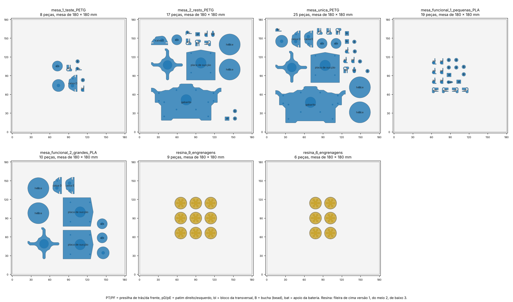
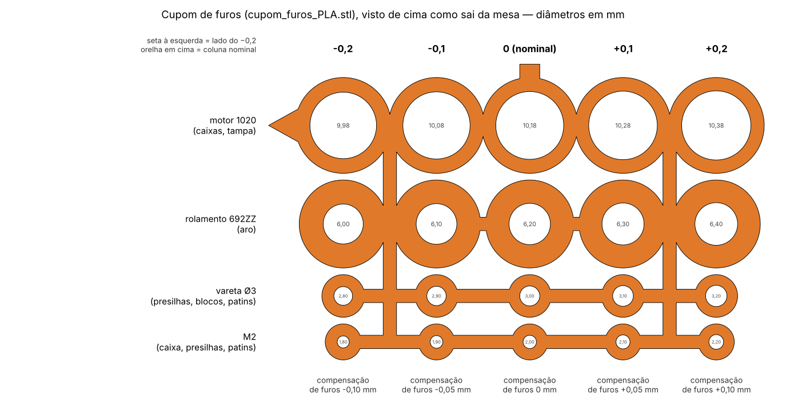

# Mecânica — peças para imprimir e montar

Peças do EVA-RT (© EXOTIC TEAM MX, AGPL-3.0) adaptadas à placa encomendada, **RUSH - SATURN v12** (asa de gaivota), com a **base de 1,6 mm** e a **barra V1 de 1,6 mm**, para imprimir em **PLA e PETG**.

| Seção | O que tem |
|---|---|
| [O que imprimir](#o-que-imprimir) | STL separados por material (`stl/PETG/`, `stl/PLA/` e `stl/RESINA/`), quantidades e configuração |
| [Primeira impressão: ventoinha e motores](#primeira-impressão-ventoinha-e-motores) | roteiro até a placa chegar: as mesas prontas (`mesas/`, um arquivo por impressão), montagem da roda e testes dos motores |
| [Ferragens](#ferragens) | varetas, parafusos, porcas, rolamentos e cola |
| [Ordem de montagem](#ordem-de-montagem) | passo a passo |
| [Cuidados](#cuidados) | o que pode dar errado na montagem e na pista |
| [Por que as peças mudaram](#por-que-as-peças-mudaram) | base de 1,6 mm, asa de gaivota, PLA/PETG e os cuidados para imprimir tudo em PLA |
| [Conferência 3D](#conferência-3d) | folgas e altura de cada peça até a pista |

A análise do suporte da barra está em [`SUPORTE_BARRA_V1.md`](SUPORTE_BARRA_V1.md). Os STL são gerados por `ferramentas/pecas_3d/gerar_pecas.py`. Os do EVA-RT são cópias de `referencias/eva-rt/3d_models/`; a carcaça e as caixas de redução só foram giradas para a posição de impressão.

## O que imprimir
As pastas separam o material ideal de cada peça. As de `stl/PLA/` também saem em PETG, e assim tudo cabe em duas mesas de PETG e uma leva de resina (ver "Primeira impressão"). O motivo de cada filamento está em "Por que as peças mudaram".

**`stl/PETG/`** (peças sob aperto de parafuso ou perto de motor):

| Arquivo | Qtde | Função |
|---|---|---|
| `presilha_vareta_tras_base1.6.stl` | 2 | presilha de trás (y = −1,75), parede na borda da base |
| `presilha_vareta_frente_asa.stl` | 2 | presilha da frente (y = 10,75), apoiada sobre a raiz da asa |
| `patim_v1_direito_barra1.6.stl` | 1 (+1 de reserva) | patim da barra V1, lado direito (+x) |
| `patim_v1_esquerdo_barra1.6.stl` | 1 (+1 de reserva) | patim da barra V1, lado esquerdo |
| `bloco_transversal_asa.stl` | 2 | une a vareta longitudinal à transversal |
| `placa_succao_rebaixo.stl` | 1 | placa de sucção de 0,6 mm, com rebaixo para a cabeça do parafuso nos 4 pés |
| `gearbox.stl` | 1 | caixa de redução **direita** (pinhão para fora) |
| `gearbox_esquerdo_espelhado.stl` | 1 | caixa de redução esquerda (o EVA-RT publica só um lado) |
| `impeller_base_1.stl` | 1 | carcaça da ventoinha (4 pés) |
| `impeller_base_2.stl` | 1 | parte de cima da carcaça, segura o motor |
| `impeller_fan.stl` | 1 | hélice |

**`stl/PLA/`** (também servem em PETG):

| Arquivo | Qtde | Função |
|---|---|---|
| `wheel_rim.stl` | 2 | aro da roda (rolamentos 692ZZ); o PLA acerta melhor a medida do alojamento, mas o PETG serve: a impressão de teste confere o rolamento |
| `battery_holder.stl` | 1–2 | apoio da bateria na vareta de trás (a foto mostra um); serve PETG também |
| `bead.stl` | 4 | bucha do eixo da roda, uma de cada lado do aro: o ressalto de Ø3,15 aperta só o anel interno do rolamento (ver "Montagem da roda"); serve PETG também |
| `gabarito_base_teste.stl` | 1 | **só para testes**: base de 1,6 mm com o contorno e os furos da placa (asas cortadas), para montar a ventoinha e as caixas antes de a placa chegar |

**`stl/RESINA/`**:

| Arquivo | Qtde | Função |
|---|---|---|
| `engrenagem_64T_m0.3_1_justa.stl` | 3 | engrenagem de 64 dentes, módulo 0,3, 2 mm, **versão 1 (justa)**: 1 furo de marca entre os pinos |
| `engrenagem_64T_m0.3_2_media.stl` | 3 | **versão 2 (média)**: 2 furos de marca |
| `engrenagem_64T_m0.3_3_folgada.stl` | 3 | **versão 3 (folgada)**: 3 furos de marca |

As três encaixam nos 6 pinos do aro e apoiam na aba dele. O EVA-RT usa uma engrenagem comprada; estas foram desenhadas para o aro dele. Elas mudam só na folga dos dentes. **Imprima as 9 juntas, numa leva só:** a resina cura a camada inteira de uma vez, então 9 peças levam o mesmo tempo que uma e gastam ~4 ml. No teste das caixas você fica com a versão mais justa que gira solta, e o resto vira reserva. Numa ida só à impressora, prefira `mesas/resina_6_engrenagens.stl` (2 de cada versão). Na impressão mínima, só as 2 engrenagens de uma versão, escolhida pela medida do pinhão (ver "Impressão mínima da resina", depois do teste das caixas). Por que três: ver "Teste das caixas".

Origem: presilhas, patins, bloco, placa de sucção e engrenagem são adaptações; o resto é do EVA-RT como está. Do EVA-RT, não entram: `sensor_sledge.stl` (barra VISION), `barilla_clamp.stl` (rasgo de 1,0 mm), `suction_base.stl` e `barilla_connection.stl` (substituídas pelas adaptadas).

### Configuração de impressão
- **Todos os STL já estão na posição de impressão. Nenhum precisa de suporte:** é só abrir no fatiador e imprimir, sem girar.
  - A carcaça (`impeller_base_1`) vai de cabeça para baixo: o topo é plano. Apoiada nos pés, teria ~490 mm² em balanço.
  - As caixas de redução vão deitadas sobre a face do pinhão. Os furos do motor (Ø10,18) e do eixo (Ø2,0) ficam na vertical: saem redondos, e o aperto do motor fica no plano das camadas, onde a peça é mais forte.
  - A placa de sucção vai com os rebaixos para cima: o fundo de 0,2 mm sai na primeira camada.
  - A hélice tem 6 corpos no STL (disco + 5 pás). O fatiador junta.
  - O aro tem um degrau interno (do furo de Ø11 para o alojamento de Ø6,2 do rolamento) e uma aba de 1,75 mm no topo. Imprime sem suporte, mas a borda de baixo do alojamento pode cair um pouco: conferir o rolamento.
  - Patim, presilhas e bloco têm o furo da vareta na vertical. O assento das presilhas e o rebaixo do bloco também saem sem suporte.
- Bico de 0,4 mm, camada de 0,16 mm com a primeira de 0,2 mm, 3 perímetros ou mais, 100% de preenchimento.
- PETG:
  - filamento seco e retração bem ajustada: fio solto desbalanceia a hélice e fecha o furo da vareta;
  - em PEI liso, passar cola bastão como separador, porque o PETG gruda demais e arranca a superfície;
  - ventilador da peça em 30–50%, parede externa devagar (~20–25 mm/s) e tempo mínimo por camada de ~10 s. Como as peças são pequenas, imprimir várias juntas também dá tempo de esfriar;
  - temperatura do bico e da mesa: as do fabricante do filamento.
- Placa de sucção: o fundo do rebaixo (0,2 mm) é a primeira camada, e a placa sai com ~0,6 mm.
- **Resina (engrenagens):**
  - Antes de imprimir, conferir o pinhão (ver "Primeira impressão").
  - Deitada, com a face paralela à mesa, sobre suportes finos a ~3 mm da mesa. Os suportes vão numa face só, no anel entre o furo central e os pinos, nunca nos dentes.
  - Não imprimir direto na mesa: as primeiras camadas recebem exposição longa e engordam os dentes. Também não inclinar, porque os suportes cairiam nos dentes.
  - As duas faces são iguais. A face dos suportes vai virada para a caixa, onde sobram 0,75 mm; lixar os toquinhos rente.
  - Camada de 0,05 mm. Se tiver resina tipo ABS ou *tough*, prefira; a comum é mais quebradiça, mas aguenta o 1020.
  - Lavar bem entre os dentes, com escova macia no álcool isopropílico, e secar antes da pós-cura. Resina que sobra no vão do dente cura junto e trava o engrenamento.
  - Pós-cura no tempo do fabricante da resina, sem exagerar: em excesso, ela fica quebradiça.
- Os furos de Ø2,0 e de Ø3,0 da vareta saem justos de propósito, como no original. Se a vareta não entrar, passar broca de 2 mm ou de 3 mm à mão. Como o furo das presilhas agora é fechado, a vareta tem de atravessar as duas presilhas e o bloco: alargar o furo só o bastante para ela deslizar com atrito.
- Hélice: conferir se gira sem bater antes de dar potência. Se vibrar, imprimir de novo.
- A impressão de teste já leva uma presilha de cada tipo e um patim: conferir na barra V1 e com a vareta (ou uma broca de 3 mm) antes do resto.
- O fundo do esqui desgasta na pista: imprimir um par de reserva.

## Primeira impressão: ventoinha e motores
Vale começar por elas. São as peças com os encaixes mais críticos (motor Ø10,18, eixo Ø2,0, rolamento Ø6,19, cubo da hélice). Imprimindo antes, um problema de medida aparece cedo, e dá para filmar a ventoinha e as caixas funcionando sem a placa, montadas no `gabarito_base_teste.stl`.

**Impressões: duas mesas de PETG e uma leva de resina.** Dá para imprimir tudo antes de a placa chegar. A primeira mesa é curta e de teste: as peças dela também entram no robô, mas só siga depois de conferir as medidas.

| Impressão | Material | Peças | Conferir antes de seguir |
|---|---|---|---|
| 1. Teste de medidas (curta) | PETG | `gearbox.stl`, `impeller_base_2.stl`, 1 `wheel_rim.stl`, 2 `bead.stl`, 1 `presilha_vareta_tras_base1.6.stl`, 1 `presilha_vareta_frente_asa.stl`, 1 `patim_v1_direito_barra1.6.stl` | motor 1020 firme na caixa e na carcaça, sem trincar; M2 passando, inclusive no furo do eixo da caixa (Ø2,0); rolamentos 692ZZ firmes no aro e pneu montado; patim na ponta da barra V1; vareta (ou broca de 3 mm) passando nas presilhas. Se algum furo sair fora, ajustar a compensação de furos (*hole/XY compensation*) do fatiador antes da 2 |
| 2. Todo o resto | PETG | `gabarito_base_teste.stl`, `impeller_base_1.stl`, `placa_succao_rebaixo.stl`, 2 `impeller_fan.stl` (1 de reserva), `gearbox_esquerdo_espelhado.stl`, 1 `wheel_rim.stl`, 2 `bead.stl`, `battery_holder.stl`, 1 `presilha_vareta_tras_base1.6.stl`, 1 `presilha_vareta_frente_asa.stl`, 1 `patim_v1_direito_barra1.6.stl` (reserva), 2 `patim_v1_esquerdo_barra1.6.stl` (1 de reserva), 2 `bloco_transversal_asa.stl` | — |
| R. Engrenagens | resina | as 9 de uma vez: 3 de cada versão (cabem em ~75 × 75 mm). Pode rodar em paralelo com a 2 | antes: conferir o pinhão (abaixo). Depois: engrenagem entrando nos pinos do aro e apoiando na aba |

**Arquivos prontos, um por impressão**, em [`mesas/`](mesas/), com as peças já posicionadas e na posição de impressão:

| Arquivo | O que é | Ocupa |
|---|---|---|
| `mesas/mesa_1_teste_PETG.3mf` | impressão 1 (teste) | 52 × 51 mm |
| `mesas/mesa_2_resto_PETG.3mf` | impressão 2 (o resto) | 143 × 144 mm |
| `mesas/mesa_unica_PETG.3mf` | a 1 e a 2 juntas, para impressora bem calibrada | 152 × 152 mm |
| `mesas/cupom_furos_PLA.stl` | cupom de furos: imprimir antes das mesas funcionais para acertar a compensação de furos (ver "Tudo em PLA") | 74 × 44 mm |
| `mesas/mesa_funcional_1_pequenas_PLA.3mf` e `.stl` | conjunto funcional em PLA, parte 1: 19 peças pequenas (6 buchas, 3 + 3 presilhas, 2 blocos, 2 + 2 patins, apoio da bateria), reservas incluídas | 58 × 56 mm |
| `mesas/mesa_funcional_2_grandes_PLA.3mf` e `.stl` | parte 2: 10 peças grandes (2 caixas, carcaça, tampa, 2 hélices, 2 placas de sucção, 2 aros), reservas incluídas | 131 × 131 mm |
| `mesas/resina_9_engrenagens.stl` | as 9 engrenagens: fileira de cima é a versão 1, a do meio a 2 e a de baixo a 3 | 68 × 68 mm |
| `mesas/resina_6_engrenagens.stl` | 2 de cada versão, uma versão por fileira (1 em cima). **A recomendada para uma ida só à impressora**: a versão só se escolhe na montagem | 44 × 68 mm |
| `mesas/resina_2_engrenagens_v1_justa.stl`, `_v2_media.stl`, `_v3_folgada.stl` | impressão mínima: só as 2 engrenagens do robô, de uma versão. Imprimir **um** dos três, escolhido pelo pinhão (ver "Impressão mínima da resina") | 44 × 20 mm |



- Abra o arquivo no fatiador e imprima: não é preciso girar nem arranjar nada.
  - Os 3MF abrem no PrusaSlicer, OrcaSlicer, Bambu Studio e Cura, com cada peça como objeto separado e nomeado. Se o fatiador avisar que o 3MF veio de outro programa, é normal: só a geometria importa.
  - As posições são para uma mesa de 180 × 180 mm, com o grupo no centro, e sobram 14 mm de margem ou mais. Numa mesa maior, se o grupo cair fora do centro, selecione tudo e centralize, sem rearranjar.
- No fatiador da resina, o STL abre como 9 peças: levante ~3 mm e ponha os suportes como em "Configuração de impressão".
- As duas mesas funcionais juntas têm as 21 peças que vão no robô e 8 reservas baratas, sem o gabarito, para imprimir em PLA numa ida só, depois do cupom de furos (ver "Tudo em PLA"). Cada uma tem também um STL, um arquivo só com as peças já posicionadas; no fatiador, "dividir em objetos" (*split to objects*) separa as peças, se preciso.
- A mesa única serve se a impressora estiver bem calibrada, com furos saindo na medida em peças anteriores. O risco: se um furo sair fora, reimprimir as caixas, a carcaça e o aro.
- Se alguma peça mudar, o `gerar_pecas.py` refaz os arquivos de `mesas/`.
- A hélice já vai na mesa 2: a solução do cubo (pinhão no eixo, ver abaixo) não muda o STL.
- Com muitas peças de PETG na mesa, ajuste bem a retração e ligue "evitar cruzar perímetros" (*avoid crossing perimeters*): fio solto na hélice desbalanceia.

**Antes da resina, conferir o pinhão** (a engrenagem só serve para pinhão de 11 dentes, módulo 0,3):
- Conte os dentes: têm de ser **11**.
- Meça com o paquímetro de uma ponta de dente ao lado oposto. Com 11 dentes, o lado oposto é um vão, e a leitura sai ~2% menor que o diâmetro:
  - ~3,8 mm: pinhão sem deslocamento de perfil;
  - ~4,0 mm: deslocamento de +0,33.
  
  As duas medidas servem.
- Se não forem 11 dentes, ou se a medida sair longe de 3,8–4,0 mm (5,1 mm, por exemplo, é módulo 0,4), **não imprima**: a engrenagem tem de ser refeita para esse pinhão.

**Roteiro até a placa chegar (5 dias):**

| Dia | Imprimir | Fazer |
|---|---|---|
| 1 | impressão 1 (teste) e, com as medidas conferidas, já começar a 2 | **pedir as varetas** (ver "Ferragens"); checar componentes da BOM e o CH340G; conferir o pinhão |
| 2 | engrenagens (resina), enquanto a 2 termina | prensar os pinhões nos 3 motores; montar uma roda completa; teste de bancada da barra V1 (`firmware/teste_barra/`) para decidir o mapa do mux |
| 3 | — | ventoinha no gabarito: teste e vídeo da sucção. Caixas e rodas no gabarito, escolhendo a versão da engrenagem: vídeo das rodas. Compilar o firmware e ajustar o `MAPA_MUX` |
| 4 | — | com as varetas: mecânica completa no gabarito. Gravar o firmware no Nano doador e testar o console pela serial |
| 5 | — | tirar o ATmega do Nano; separar os componentes por etapa de solda; cabo misto da barra; fios dos motores |

**Montagem no gabarito:**
- A frente do gabarito é o lado da aba da J2.
- Carcaça com os dois pés de orelha para a frente. Por baixo, a placa de sucção com os rebaixos virados para fora, presa com 4× M2 × 6 que fazem rosca direto nos pés.
- Caixas de redução: M2 × 6 e porca, como na placa.
- O gabarito tem a mesma espessura da placa (1,6 mm), então os comprimentos de parafuso são os mesmos. Os furos dele são de Ø2,2, para o M2 passar sem broca.

**Cubo da hélice (resolver antes de montar a hélice):**
- O furo do cubo tem Ø3,4 e atravessa o cubo todo (4 mm), mas o eixo do 1020 tem 1,2 mm. O EVA-RT não documenta o que vai no meio.
- Pela medida, o mais provável é um **pinhão 11T M0,3 prensado no eixo da ventoinha** (furo de 1,15 mm, como nos motores das rodas). O pinhão é então cravado no cubo, com os dentes (Ø3,9) mordendo o plástico, mais uma gota de cola.
- Confira se sobrou um pinhão para o terceiro motor.
- Não use a hélice solta no eixo, nem com cola só no eixo de 1,2 mm.

**Teste da ventoinha:**
- Fonte de bancada com limite de corrente, começando em ~3 V e subindo até 7,4 V. Sem a placa, o motor recebe tensão cheia, sem PWM.
- Use óculos de proteção: a ~50 mil rpm, uma pá que se solta vira projétil.
- Conferir se a hélice gira sem raspar e sem vibrar.
- Conferir o sentido: um papel encostado no furo de Ø17, por baixo, tem de ser puxado. Se for soprado, inverta os fios.
- **Para o vídeo da sucção:** apoie o conjunto sobre a manta ou uma superfície lisa e mostre que ele gruda. Para medir, puxe-o para cima com uma balança de mão ou um dinamômetro.
- Pôr o conjunto em cima de uma balança de cozinha não mede nada: a força fica entre o conjunto e o prato.

**Montagem da roda** (como no EVA-RT, conferido pelo STL do aro e pelas fotos):
- O aro gira em 2 rolamentos 692ZZ sobre um eixo fixo, que é um **parafuso M2 × 30**. O eixo do motor não encosta na roda: ele só gira o pinhão.
- Pneu: StickyMAX de 22 mm da RoboCore (Ø22 × 15 mm, furo de Ø12). Ele entra no assento de Ø13 do aro com 1 mm de aperto; água com sabão ajuda. Esticado, fica com ~Ø22,5. O lado do pneu com o rebaixo de Ø15 vai contra a aba do aro.
- Rolamentos:
  - o de fora vai no fundo do vão de Ø11, a 6 mm da ponta;
  - o de dentro fica rente à aba.
- Engrenagem de resina: entra nos 6 pinos do aro e apoia na aba. Os pinos ficam rentes à face dela.
  - O furo dos pinos (Ø3,25 para pino de Ø3,09) é justo de propósito, para a engrenagem ficar centrada. Se não entrar, lixe os pinos de leve e por igual.
  - Só cole (uma gota de cianoacrilato por pino, sem escorrer para os dentes) depois de escolher a versão no teste das caixas.
- Buchas (`bead.stl`), uma de cada lado, com o ressalto de Ø3,15 virado para o rolamento:
  - por fora, entre a cabeça do parafuso e o rolamento;
  - por dentro, entre o rolamento e a caixa de redução.
  
  Elas apertam só o anel interno, que fica parado com o eixo. Sem elas, a cabeça do parafuso e a caixa raspariam na blindagem do rolamento, que gira com o aro.
- O parafuso atravessa a roda, a bucha de dentro e a caixa (furo de Ø2,0), e leva a porca do lado de dentro da caixa. Se sobrar ponta depois da porca, cortar.
- Pinhão: prensar no eixo do motor (na morsa, sem martelo) de modo que cubra a faixa de **0,75 a 2,75 mm a partir da face da caixa**. É onde fica a engrenagem.

**Teste das caixas e escolha da engrenagem:**
- Monte a caixa no gabarito, com o motor, o pinhão e a roda completa, **com a engrenagem ainda sem cola**.
- Comece pela versão 1 (1 furo de marca). Gire a roda com a mão uma volta inteira:
  - se prender em algum ponto, troque pela 2 e depois pela 3;
  - fique com a mais justa que gira solta a volta toda.
- Ligue o motor direto na fonte, começando em ~3 V: a roda tem de girar macia, sem estalo e sem travar em nenhum ponto.
- Use a mesma versão nas duas rodas; as outras ficam de reserva. Só então cole.

Por que três versões:
- A distância entre o eixo do motor e o da roda na `gearbox.stl` é de 11,35 mm, e a nominal para 64 + 11 dentes é 11,25. Os 11,35 mm são exatamente a distância de engrenamento sem folga de um pinhão com deslocamento de perfil +0,33 (11,346): é o pinhão mais provável do EVA-RT. Mas não dá para saber de antemão:
  - qual é o seu pinhão (medir, ver acima);
  - quanto a caixa de PETG encolhe (ela pode sair uns 0,05–0,1 mm mais curta);
  - quanto a sua impressora de resina engorda o dente.
- As versões tiram progressivamente mais da espessura do dente e aprofundam o fundo dele. A 2 e a 3 também encurtam a ponta.

Conferência 2D (`conferencia/engrenamento.png`): menor distância entre os dentes na pior posição da volta, em mm. A folga total entre dentes é ~o dobro, e o valor negativo trava.

| Versão (marca) | Pinhão sem deslocamento: caixa / caixa 0,1 mm mais curta | Pinhão +0,33: caixa / caixa 0,1 mm mais curta | Razão de contato (sem desl. / +0,33) |
|---|---|---|---|
| 1 justa (1 furo) | 0,064 / 0,024 | 0,030 / **−0,006 (trava)** | 1,28 / 1,45 |
| 2 média (2 furos) | 0,082 / 0,044 | 0,048 / 0,006 | 1,19 / 1,37 |
| 3 folgada (3 furos) | 0,101 / 0,064 | 0,067 / 0,031 | 1,11 / 1,29 |

- Com uma razão de contato abaixo de ~1,2, os dentes trocam de contato com mais tranco. Por isso a escolha é a mais justa que gira solta, e não a mais folgada.
- **Caixa em PLA:** o PLA encolhe menos que o PETG, então a caixa fica mais perto dos 11,35 mm. O caso que trava na tabela (versão 1, caixa 0,1 mm mais curta) fica menos provável, mas as três versões continuam valendo, porque o pinhão e a resina seguem desconhecidos.
- Se até a 3 travar, a causa é a impressão: dente engordado ou resina que ficou no vão. Escove os vãos com álcool isopropílico e confira de novo.

**Impressão mínima da resina (só as 2 engrenagens do robô).** Se só houver uma leva de resina, prefira `mesas/resina_6_engrenagens.stl`: a versão só se escolhe na montagem, com o motor, e a resina cura a camada inteira de uma vez, então 6 peças levam o mesmo tempo que 2 e gastam ~2 ml a mais. Sem as três versões na mão, a escolha vem antes, pela medida do pinhão (ver "Antes da resina, conferir o pinhão"), e pela tabela acima:

| Pinhão no paquímetro | Arquivo | Por quê |
|---|---|---|
| ~3,8 mm (sem deslocamento) | `mesas/resina_2_engrenagens_v1_justa.stl` | não trava em nenhum caso da tabela e tem a maior razão de contato (1,28) |
| ~4,0 mm (+0,33) | `mesas/resina_2_engrenagens_v2_media.stl` | a v1 trava se a caixa sair 0,1 mm mais curta; a v2 fica com 0,006–0,048 mm e contato de 1,37 |
| sem medir | `mesas/resina_2_engrenagens_v2_media.stl` | não trava em nenhum caso da tabela, e a razão de contato fica em 1,19 ou mais |

- Se a escolhida travar mesmo com os vãos limpos, imprima o arquivo da versão seguinte, numa nova leva de resina.

## Ferragens
| Item | Qtde | Onde |
|---|---|---|
| Vareta Ø3 mm × 94 mm (carbono ou fibra de vidro maciça) | 3 | 2 longitudinais + 1 transversal (o EVA-RT usa tubo de carbono). **Não imprimir**: ver abaixo |
| Vareta Ø3 mm × ~80 mm | 1 | traseira, entre as caixas de redução (comprimento estimado, medir na montagem) |
| Parafuso M2 × 30 + porca M2 | 2 | eixo das rodas (ver "Montagem da roda") |
| Pneu StickyMAX 22 mm (RoboCore) | 2 | um por aro |
| Parafuso M2 × 6 + porca M2 | 4 | presilhas: cabeça por baixo da base, porca em cima do braço (base 1,6 + braço 1,0 + porca 1,6 = 4,2 mm) |
| Parafuso M2 × 8 + porca M2 | 2 | patins, com a cabeça por baixo e a porca em cima. A pilha é de 7,8 mm (braço 1,0 + barra 1,6 + folga 0,1 + bloco 3,5 + porca 1,6): o M2 × 8 fica justo, e o M2 × 10 dá folga |
| Parafuso M2 × 6 + porca M2 | 4 | caixas de redução. A pilha é de 5,7 mm (pé 2,5 + base 1,6 + porca 1,6), sem sobra: se a porca não pegar a rosca inteira, usar M2 × 8 |
| Parafuso M2 × 6, rosca direto no plástico | 4 | por baixo: fundo do rebaixo da placa de sucção → base → pés da carcaça (furo Ø1,85, 5 mm de fundo; entram 4,2 mm) |
| Rolamento 692ZZ (2 × 6 × 3) | 4 | dois por aro |
| Cola (cianoacrilato; epóxi se o PETG não colar) | — | travar patins e presilhas na vareta, depois de acertar a distância |

Total: 12× M2 × 6, 2× M2 × 8, 2× M2 × 30, 12 porcas M2.

**Varetas: comprar, não imprimir.**
- Uma vareta de 1 m dá as quatro (3 × 94 + ~80 = ~362 mm).
- As varetas não seguram só a barra: o esqui é o apoio da frente do robô, com as rodas atrás.
  - Cerca de ¼ do peso e da sucção vai para os esquis: ~0,5 N em cada, numa estimativa em que a sucção não foi medida.
  - A vareta trabalha em balanço, com 54–63 mm entre o bloco ou a presilha da frente e o patim.
- Quando a vareta flete, a frente da base desce, e na altura dos QRE de marca ela desce ~0,4 vez a flexão. Os QRE ficam a 0,7 mm da pista, e as cabeças de parafuso a 0,6–0,8 mm.

| Vareta Ø3 | Flexão na ponta (mm) | Base desce nos QRE (mm) | Massa das 4 | Serve? |
|---|---|---|---|---|
| carbono maciço | 0,06–0,09 | 0,02–0,04 | 4,0 g | sim |
| tubo de carbono 3 × 2 (o do EVA-RT) | 0,07–0,11 | 0,03–0,04 | 2,2 g | sim |
| fibra de vidro maciça | 0,17–0,26 | 0,07–0,11 | 5,1 g | sim |
| alumínio maciço (por exemplo, agulha de tricô de 3,0 mm) | 0,10–0,15 | 0,04–0,06 | 6,9 g | sim |
| inox ou aço | 0,03–0,05 | 0,01–0,02 | 20 g | sim, mas pesa |
| barra roscada M3 (aço) | 0,08–0,13 | 0,03–0,05 | 14 g | sim, mas pesa |
| palito de bambu | 0,44–0,70 | 0,18–0,28 | 1,8 g | só para montar e testar na bancada |
| impressa em filamento com fibra (PLA-CF, PETG-CF) | 1,3–2,1 | 0,5–0,8 | — | não |
| impressa em PLA | 2,2–3,5 | 0,9–1,4 | — | não: a base arrasta na pista |
| impressa em PETG | 3,5–5,5 | 1,4–2,2 | — | não |

- O filamento com fibra de carbono tem fibra picada. Fica 2 a 3 vezes mais rígido que o PETG, enquanto a vareta de carbono, de fibra contínua, é ~60 vezes. Não resolve a vareta, e as outras peças já foram adaptadas para PLA e PETG.
- Uma vareta impressa também não sai reta e redonda o bastante para deslizar nos furos.
- O peso conta: massa na frente aumenta a inércia nas curvas. Por isso, inox e barra roscada só em último caso.
- Fibra de vidro: a maciça de Ø3,0 mm, como a de pipa e de aeromodelismo. Conferir o diâmetro com o paquímetro antes de comprar mais.
- Para montar na bancada enquanto as varetas não chegam, serve um palito de bambu de 3 mm ou uma broca de 3 mm.
- **Sem tempo para encomendar**, o que se acha em loja física:
  - **agulha de tricô de alumínio de 3,0 mm** (armarinho, loja de aviamentos, papelaria). É maciça, reta, de diâmetro certo e leve. O par de 35 cm dá as quatro varetas: cortar com serra de arco, longe da ponta e do botão, e tirar a rebarba. Não serve a de plástico; a de bambu, só para teste;
  - vareta de fibra de vidro ou de carbono de 3 mm em loja de pipa, de pesca ou de aeromodelismo;
  - eixo de aço prata (retificado) de 3 mm em loja de rolamentos ou de ferramentas industriais: serve, mas pesa ~20 g;
  - sobra de vareta ou tubo de carbono de 3 mm nos laboratórios (de robótica ou aeromodelismo). O que vale pedir é a vareta, não o filamento.

Use cabeça cilíndrica ou abaulada de até Ø3,8 × 1,6 mm, sem arruela. Cabeça mais alta encosta na pista (ver alturas abaixo).
- A cabeça da presilha da frente direita fica a 0,13 mm do R25, que está embaixo da placa.
- A cabeça da presilha de trás esquerda apoia sobre uma via de GND (tented). Só encosta em GND, então não tem problema.

## Ordem de montagem
1. Soldar tudo na base e na barra antes. Três cuidados:
   - **Cortar rente**, embaixo, os terminais de J1, J2 e J4 e as pontas dos fios dos motores. Com a base de 1,6 mm sobram só 2,4 mm entre a placa e a pista.
   - Soldar a J2 bem reta, porque a vareta transversal passa a 0,23 mm dela.
   - J3 (gravação): ver "Cuidados".
2. Passar cada vareta longitudinal, pela ponta, pelas duas presilhas e pelo bloco da transversal. O furo das presilhas é fechado.
3. Encaixar as presilhas na base e prender cada uma com M2 × 6 de baixo para cima, com a porca em cima do braço:
   - **atrás**, a parede externa encosta na borda em x = ±50, sobre os furos (±43,75; −1,75);
   - **na frente**, a presilha apoia sobre a raiz da asa, sobre os furos (±43,75; 10,75).
4. Encaixar a vareta transversal nos furos cegos dos dois blocos. Ela passa logo atrás da J2, com o eixo em y ≈ 19,75. No Saturn, ela só encosta na base perto do centro: fora de x ≈ ±13 não há placa embaixo dela.
5. Montar a carcaça da ventoinha com **os dois pés de orelha para a frente**, com as orelhas por cima da transversal. Por baixo, pôr a placa de sucção com os rebaixos virados para a pista. Prender com 4× M2 × 6, que atravessam o fundo do rebaixo e a base e fazem rosca direto no plástico dos pés.
6. Conferir se as 4 cabeças ficaram dentro dos rebaixos.
7. Encaixar os patins nas pontas da barra, com o esqui para fora e a ponta curva para a frente. Pôr o M2 × 8 sem apertar e passar as varetas pelos canais.
8. Deslizar a barra até **63,14 mm** entre o furo da frente da base e o furo da barra. A mesma cota dá 57,89 mm entre a face da frente da presilha dianteira e a face de trás do patim. Conferir os dois lados iguais e apertar.
9. Com a distância aprovada na pista, travar cada patim e cada presilha na vareta com uma gota de cola (ver "Só PLA e PETG").

Resultado esperado:
- varetas paralelas em x = ±48,45;
- face de baixo da barra a 3,4 mm da pista (QRE da barra a ~1,7 mm);
- L = 107,1 mm.

A distância se ajusta deslizando o patim na vareta. Com varetas de 94 mm vai de ~20 a ~73 mm entre furos.

## Cuidados
- **J3 (gravação, embaixo):** a mesma solução do perseguidor (mesma posição e footprint). É uma barra de pinos reta deitada:
  - os pinos curtos ficam soldados nos pads;
  - a parte preta fica encostada na borda de trás (y = −30), atrás da placa e centrada no pino;
  - fica a 0,8 mm da pista, menos a solda. Não deixar a parte preta embaixo da placa.
- **Cabeças de parafuso:** são as partes mais baixas depois do esqui: 0,6 mm nos pés da carcaça, 0,7 mm nos patins e 0,8 mm nas presilhas e nas caixas.
- **Placa de sucção:** usar a `placa_succao_rebaixo.stl`. Com a `suction_base.stl` original, a cabeça dos pés fica a 0,2 mm da pista. Não abrir o rebaixo até a base: o fundo de plástico isola a cabeça de aço das vias de PWMA_D5, PWMB_D6 e GND. Se 0,6 mm raspar na pista, a alternativa é furo passante de Ø4,4 com parafuso de náilon (0,8 mm).
- **Carcaça da ventoinha:** montar com os dois pés de orelha para a frente.
- **Carbono conduz.** As longitudinais ficam 1 mm acima da placa. A transversal deita sobre a máscara de solda só perto do centro: ali não há via, e os pads mais próximos são os da J2, a 0,7 mm.

## Por que as peças mudaram
### Base de 1,6 mm
O EVA-RT foi feito para base de 1,0 mm. Com 1,6 mm:
- **Presilhas da vareta:** o rasgo do `barilla_clamp` é de 1,0 mm. Com o braço de baixo, a cabeça do parafuso ficaria abaixo da pista. As presilhas novas não têm esse braço: o parafuso aperta o braço de cima direto na base, com a cabeça embaixo da placa. A solução veio do perseguidor RUSH - Dreamcast.
  - **Atrás** (y = −1,75), a borda é reta em x = ±50. A parede externa desce até a face de baixo e encosta nela, como no perseguidor.
  - **Na frente** (y = 10,75), a presilha fica sobre a raiz da asa, e ali a placa vai além de x = 50. Por isso esta presilha não tem a parede que desce: apoia inteira em cima da placa, e a vareta, presa na de trás, não a deixa girar.
- **Placa de sucção:** no EVA-RT, a cabeça dos 4 parafusos dos pés da carcaça aperta a placa de sucção contra a base. Com 1,6 mm, essa cabeça ficaria a 0,2 mm da pista. A placa nova tem um rebaixo de Ø4,4 em cada pé, com fundo de 0,2 mm: a cabeça entra na placa e fica a 0,6 mm da pista. O fundo de plástico continua isolando a cabeça das vias que há embaixo dela (PWMA_D5, PWMB_D6 e GND, nos pés de trás), então não dá para trocar o rebaixo por furo passante com parafuso de aço.
- **Barra V1 de 1,6 mm:** o patim é a versão para 1,6 mm, o mesmo do perseguidor. A barra fica a 3,4 mm da pista (4,0 mm com barra de 1,0 mm).
- **Parafusos:** comprimentos conferidos para 1,6 mm (tabela abaixo).

Por causa da asa de gaivota, que não depende da espessura:
- **Bloco da transversal:** o `barilla_connection` desce 1 mm abaixo da face de cima da base. No EVA-RT ele fica à frente da placa; no Saturn, a raiz da asa passa embaixo dele. O bloco novo tem um rebaixo no contorno da placa, com 0,3 mm de folga. É a mesma peça nos dois lados, e o furo da transversal fica igual.

E por imprimir só em PLA e PETG (ver abaixo):
- **Presilhas com assento:** na presilha original, o canal da vareta é aberto para a placa, e sobra 1 mm de vão sob a vareta. A altura dela depende só do aperto do canal e de cola. As presilhas deste kit têm o furo fechado embaixo: a vareta fica presa para cima e para baixo e entra pela ponta.


### Só PLA e PETG
O README do EVA-RT não informa o filamento. Nas fotos, a carcaça da ventoinha é branca, de filamento comum, e as peças pequenas são pretas e foscas. Podem ser de fibra de carbono ou só de filamento preto: não dá para saber. O carbono documentado são as varetas, que são tubos comprados prontos, não impressos.

Sem fibra de carbono, as peças ficam menos rígidas (PETG ≈ 2 GPa, PLA ≈ 3,5 GPa; com fibra, até 2 a 3 vezes mais) e o PETG amolece menos com calor (~80 °C, contra ~55–60 °C do PLA). O que isso muda:
- **Presilhas:** ganharam o assento descrito acima. É a única peça que dependia do aperto do plástico para segurar a vareta na altura certa. No patim a vareta já apoia na barra e no assento, e no bloco ela passa por furos fechados.
- **Cola:** o cianoacrilato cola bem no PLA e mal no PETG.
  - Com o assento, a cola não segura mais a altura da vareta: serve só para travar o patim e as presilhas na posição ao longo dela.
  - No PETG, lixar a superfície antes de colar. Se mesmo assim soltar, usar epóxi, ou uma volta de fita isolante na vareta logo atrás do patim, como batente.
- **Hélice:** a ~50 mil rpm, a tensão na raiz das pás fica em ~5 MPa (estimativa grosseira). É uma fração da resistência do PETG e do PLA, então nenhum dos dois precisa de fibra.

Por que cada peça está em cada pasta:

| Peça | Material | Por quê |
|---|---|---|
| presilhas, patins, bloco da transversal | **PETG** | braço de 1 mm apertado por parafuso e pancada em batida: o PLA racha |
| caixas de redução | **PETG** | seguram o motor 1020, que esquenta; no PLA o motor afrouxa e o engrenamento (módulo 0,3) sai do lugar |
| `impeller_base_1/2` (carcaça) | **PETG** | motor da ventoinha encostado |
| hélice | **PETG** | o cubo fica no eixo do motor, que esquenta |
| placa de sucção | **PETG** | o fundo do rebaixo tem 0,2 mm, e a cabeça do parafuso gira em cima dele ao apertar: o PLA trinca |
| aros | **PLA** (ou PETG) | alojamento do rolamento preciso (Ø6,19 × 3,0); o PLA acerta melhor a medida, e em PETG a impressão de teste confere o rolamento |
| apoio da bateria, bucha (`bead`) | PLA ou PETG | sem esforço |

### Tudo em PLA (mesas funcionais)
Decisão de 26/11/2026: o conjunto que vai no robô sai todo em PLA, numa ida só à impressora (sem chance de reimprimir), e a montagem é feita em casa. A geometria das peças não muda, e todas saem sem suporte também em PLA. Mudam a impressão, as reservas e a montagem.

**Levar para a impressora:** 1 motor 1020, 1 rolamento 692ZZ, a vareta (ou uma broca de 3 mm), 1 parafuso M2, o paquímetro e um estilete.

**Ordem das impressões:**

| # | Arquivo | Peças | Por quê |
|---|---|---|---|
| 0 | `mesas/cupom_furos_PLA.stl` | cupom de furos (~5 g, 74 × 44 × 3 mm) | acerta a compensação de furos antes das peças. O aperto do motor e do rolamento não se corrige depois |
| 1 | `mesas/mesa_funcional_1_pequenas_PLA.3mf` | 6 buchas, 3 + 3 presilhas, 2 blocos, 2 + 2 patins, apoio da bateria (19) | é rápida, e se uma peça pequena soltar da mesa não estraga as grandes |
| 2 | `mesas/mesa_funcional_2_grandes_PLA.3mf` | 2 caixas, carcaça, tampa, 2 hélices, 2 placas de sucção, 2 aros (10) | as peças sem conserto, já com a compensação acertada. A hélice sai numa mesa com poucas peças e pega menos fio |

**Reservas:** só das peças baratas que podem falhar em casa.
- 2 buchas, porque somem fácil.
- 1 presilha de cada tipo e 1 patim de cada lado: racham no PLA, e o esqui do patim gasta.
- 1 placa de sucção, porque o fundo de 0,2 mm trinca.
- 1 hélice, caso vibre.
- Sem reserva:
  - caixas, carcaça, tampa e aros: o risco deles é a medida, que o cupom resolve;
  - blocos: não levam parafuso.
- No 3MF, cada reserva é um objeto separado e pode ser apagada no fatiador.

**Cupom de furos:**



- **Como ler:**
  - Cada fileira repete um furo das peças, com 5 diâmetros.
  - A coluna do meio, a da orelha, tem a medida das peças. A seta fica do lado do −0,2.
  - Testar pela face de cima, a que ficou para cima na impressão. Se a primeira camada fez rebarba (pé de elefante), raspar com o estilete.
- **Motor:** empurrar o 1020 com a mão em cada furo da primeira fileira. Ficar com o menor furo em que ele:
  - entra com pressão firme da mão;
  - não trinca nem branqueia o anel;
  - não cai com o cupom de cabeça para baixo.
- **Rolamento:** o mesmo teste, com o polegar. Ele deve pedir a mesma coluna do motor ou a vizinha.
- **Compensação de furos do fatiador = desvio da coluna ÷ 2**, como está escrito embaixo de cada coluna. Positivo aumenta o furo. Aplicar nas duas mesas.
  - O nome é *X-Y hole compensation* no OrcaSlicer e no Bambu Studio, e *Hole Horizontal Expansion* no Cura.
  - Não usar a compensação de tamanho geral (*XY size compensation*): ela também muda o lado de fora, como os pinos onde a engrenagem encaixa. Se o fatiador não tiver a compensação só de furos, imprimir com 0 e acertar em casa, como no item abaixo.
- **Se o motor e o rolamento pedirem colunas diferentes,** ficar com a do motor.
  - Rolamento justo: lixar o alojamento com lixa enrolada num palito.
  - Rolamento folgado: uma gota mínima de cianoacrilato no anel de fora, sem escorrer para a blindagem.
- **Se nem o furo da ponta servir,** usar a compensação da ponta (−0,10 ou +0,10) e acertar em casa: motor frouxo se prende com uma gota de cianoacrilato; motor apertado se acerta com lixa.
- **Vareta e M2:** as duas fileiras de baixo mostram como esses furos vão sair com a compensação escolhida. Se ficarem justos, passar broca de 3 mm ou de 2 mm à mão em casa, como o guia já prevê.

**Configuração (PLA):**
- Bico de 0,4 mm, camada de 0,16 mm (a primeira de 0,2 mm), 3 perímetros ou mais e 100% de preenchimento, como antes.
- Ventilador da peça a 100% depois das primeiras camadas. Temperatura do bico e da mesa: as do fabricante. Em PEI liso não precisa de cola.
- A primeira camada tem de sair com 0,2 mm: é o fundo do rebaixo da placa de sucção.
- **Mesa 1 (pequenas):**
  - peças pequenas esquentam camada sobre camada: tempo mínimo por camada de ~10 s e parede externa devagar (~20 mm/s);
  - buchas e presilhas têm pouca área na mesa. Se soltarem, usar *brim* só nelas.
- Conferir cada mesa ao tirar, ainda na impressora:
  - vareta nas presilhas e nos blocos;
  - motor numa caixa e na tampa;
  - rolamento num aro;
  - hélice sem fios.

**Montagem, peça por peça** (os riscos são os da tabela acima):

| Peça | Risco no PLA | O que fazer |
|---|---|---|
| presilhas | o braço de 1 mm racha no aperto ou numa batida | arruela M2 pequena (Ø4,5, DIN 433) entre a porca e o braço: a pilha vai a ~4,5 mm e o M2 × 6 ainda sobra. Apertar só até firmar. Embaixo da cabeça, continua sem arruela |
| patins | braço de 1 mm entre a cabeça e a barra | apertar só até firmar. Nada embaixo da cabeça (fica a 0,7 mm da pista) |
| caixas de redução | o 1020 esquenta. Perto de ~55 °C o PLA cede: o motor afrouxa e o engrenamento sai do lugar | não deixar a roda travada com o motor ligado. Nos primeiros testes, tocar no motor: se não der para segurar, parar e esfriar. Se o motor afrouxar, uma gota de cianoacrilato o prende (cola bem no PLA), mas aí ele só sai cortando a caixa |
| carcaça e tampa da ventoinha | o motor da ventoinha roda a corrida inteira e encosta na tampa: é a peça mais exposta ao calor | testar a sucção em rajadas curtas e conferir a temperatura. Se a tampa deformar ou o motor ficar folgado, reimprimir as duas em PETG |
| hélice | o cubo fica no eixo do motor, que esquenta | o cianoacrilato do pinhão no cubo cola bem no PLA. Conferir se a hélice não entortou depois dos primeiros testes |
| placa de sucção | o fundo de 0,2 mm trinca com a cabeça girando em cima dele. Sem esse fundo, a cabeça de aço encosta nas vias de PWMA_D5, PWMB_D6 e GND | apertar devagar e parar quando a cabeça encostar. Depois, com o multímetro, conferir que não há curto entre GND e PWMA_D5 nem entre GND e PWMB_D6 |
| pés da carcaça (rosca no plástico) | o PLA trinca se forçar | rosquear devagar, sem forçar no fim |
| aros, buchas, apoio da bateria | — | nos aros, o PLA é o melhor material: acerta melhor o alojamento do rolamento |

O cianoacrilato cola bem no PLA: travar patins e presilhas na vareta fica mais fácil que no PETG.

## Conferência 3D
Feita por `ferramentas/pecas_3d/conferir_montagem.py`.
O script monta as peças e lê as placas dos arquivos do repositório:
- a base é lida do `.epro` do v12 (`hardware/placa_base/`), com 1,6 mm;
- a V1 é lida do Gerber, com 1,6 mm;
- entram também varetas, presilhas, blocos, carcaça, patins, parafusos, porcas, placa de sucção, a J3 deitada e os componentes da face de baixo (QRE de marca, D1 e os 0603, como envelopes com a altura máxima do datasheet).

A saída completa (todas as folgas e alturas) está em `conferencia/relatorio.txt`. O que ele encontra:
- Nenhuma interferência, a não ser a parede da presilha de trás, que entra 0,05 mm na borda da base, como o `barilla_clamp` no próprio EVA-RT.
- Bloco da transversal × raiz da asa: 0,2 mm de folga. Sem o rebaixo, o bloco entraria 5,5 mm³ na asa.
- Porca da presilha, com uma face virada para a vareta: 0,2 mm do ressalto (como no original) e 1,2 mm da vareta.
- Cabeças de parafuso × componentes de baixo: o mais perto é o R25, a 0,13 mm da cabeça da presilha da frente direita.
- Engrenagens de resina sobre o `wheel_rim.stl`, em 3D: as três versões apoiam na aba sem interferência, e os pinos (2,0 mm) ficam rentes à face.
- Engrenagens × pinhão 11T: tabela em "Teste das caixas", com a distância lida da `gearbox.stl` e com ela 0,05 e 0,10 mm mais curta ou 0,10 mm mais longa. Na distância da caixa, nenhuma versão trava com nenhum dos dois pinhões.
- Vias sob as peças (todas tented, pedido da JLC):
  - as cabeças dos pés de trás da carcaça ficam sobre vias de PWMA_D5, PWMB_D6 e GND, e o fundo do rebaixo da placa de sucção as isola;
  - a presilha da frente apoia sobre vias de +5V e GND, mas é de plástico;
  - as varetas longitudinais passam 1 mm acima da placa.

**Altura até a pista**, com a vareta paralela à pista e pneu de Ø22 (o StickyMAX). Pela caixa de redução, o eixo da roda fica 7,0 mm acima da base. Esticado no aro, o pneu fica com ~Ø22,5: a traseira sobe ~0,25 mm, então a tabela é o pior caso. A sucção amassa o silicone e devolve parte disso.

| Peça | Altura (mm) |
|---|---|
| face de baixo da base | 2,4 |
| placa de sucção | 1,8 |
| presilhas (parede da de trás) | 2,3 |
| cabeça do parafuso das presilhas e das caixas | 0,8 |
| cabeça do parafuso dos pés da carcaça (no rebaixo da placa de sucção) | 0,6 |
| idem, com a `suction_base` original (cabeça sobre a placa) | 0,2 |
| cabeça do parafuso dos patins | 0,7 |
| J3: parte preta da barra de pinos deitada | 0,8 (menos a solda) |
| **QRE de marca S1 a S4 (face do sensor)** | **0,7** |
| D1 (SOD-123) | 1,05 |
| resistores e capacitores 0603 de baixo | 1,5 |
| bloco da transversal | 3,0 |
| face de baixo da barra V1 | 3,4 |

Com base de 1,0 mm, tudo o que fica embaixo da base estaria 0,6 mm mais alto (por exemplo, os QRE de marca a 1,3 mm). O resto da mecânica fica em cima da base.
- Os QRE de marca ficam bem mais perto da pista que os da barra (0,7 contra ~1,7 mm). Calibrar os limiares de cada um separadamente.
- S1/S4 ficam na ponta da asa, a 36 mm em balanço: conferir na pista se raspam em emenda da manta ou em lombada.
- Pneu maior levanta a traseira: 1 mm a mais no raio dá ≈ 0,7 mm a mais nas presilhas.


O corte pelo patim (`conferencia/corte_patim.png`) e a comparação com o patim original (`conferencia/patim_original_x_novo.png`) dependem só da barra. As fotos do EVA-RT montado estão em `conferencia/eva-rt_fotos_montagem.jpg`.

Para refazer (Python 3 com `pip install -r ferramentas/pecas_3d/requisitos.txt`; rodar na raiz do repositório):
```bash
python3 ferramentas/pecas_3d/gerar_pecas.py
```
```bash
python3 ferramentas/pecas_3d/conferir_montagem.py --furos 63.14 --esp-barra 1.6
```
Se mudar a distância entre furos ou a espessura da barra, rodar de novo o `conferir_montagem.py`.

## Não conferido
- Cubo da hélice: furo de Ø3,4 para eixo de 1,2 mm (ver "Primeira impressão").
- Pinhão 11T comprado: o deslocamento de perfil não é conhecido (medir antes da resina). O engrenamento foi conferido em 2D para 0 e +0,33, não com a peça real.
- O quanto a resina engorda o dente e o quanto a caixa (PETG ou PLA) encolhe dependem das impressoras: é o que as três versões cobrem.
- Buchas (`bead.stl`) e eixo M2 × 30: posição deduzida das medidas do aro e da foto do EVA-RT (porca do lado de dentro), não de documentação.
- Encaixe dos motores 1020 nas caixas de redução e na carcaça.
- Comprimento da vareta traseira e posição do apoio da bateria com a GNB 350 mAh.
- Módulo HC-05 em pé na J4: a conferência vê só a barra fêmea, não o módulo.
- Nada foi impresso nem testado fisicamente: a conferência foi toda em 3D.
