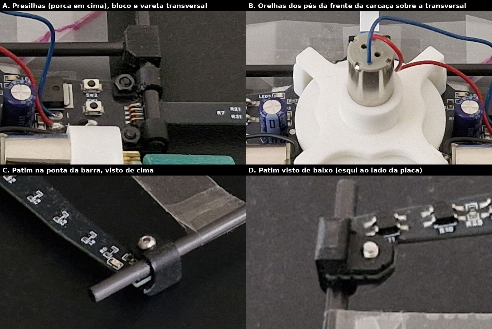
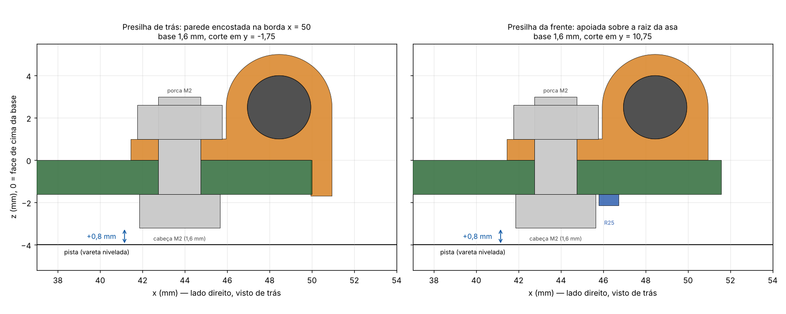
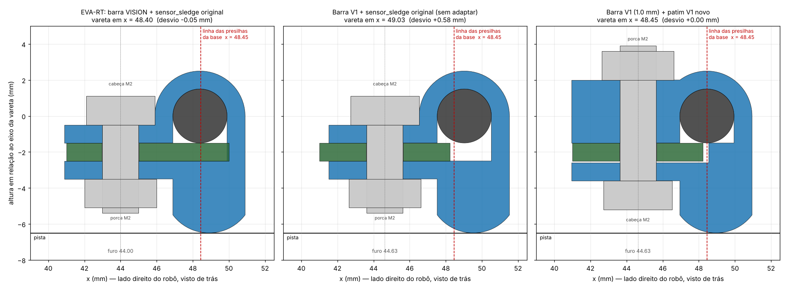
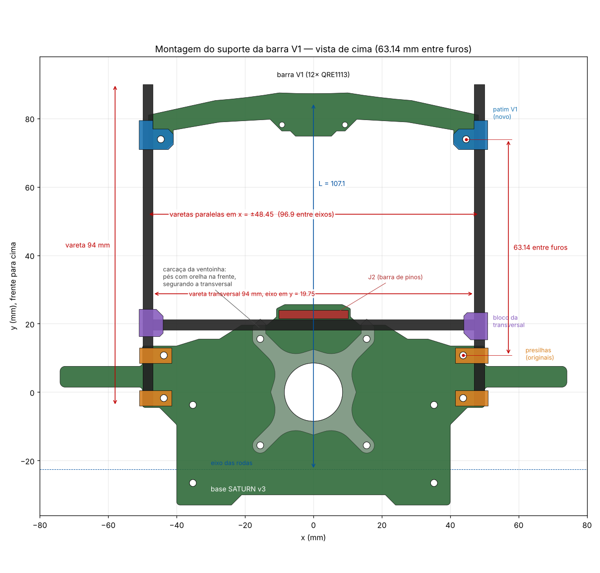
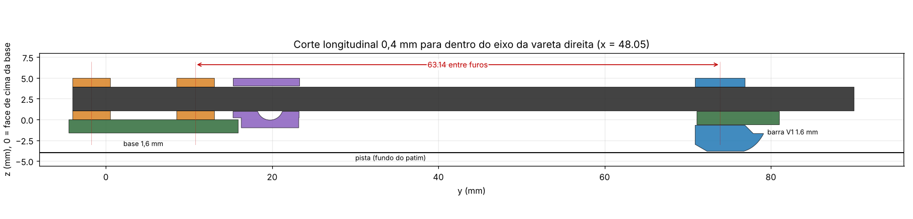

# Suporte da barra V1 na base SATURN v12 (17/11/2026)

_Origem = centro da ventoinha, +y = frente, z = 0 na face de cima da base, mm. Peças e medidas originais: EVA-RT, © EXOTIC TEAM MX, AGPL-3.0._

Fontes conferidas:
- `hardware/placa_base/ProPrj_RUSH - SATURN - v12_2026-11-15.epro` (placa encomendada, FR-4 de 1,6 mm);
- `hardware/barra_v1/` (Gerber da V1, que tem 1,6 mm, medida pelo Erick);
- `referencias/eva-rt/` (STL, Gerber e camada Document) e as fotos do repositório do EVA-RT (commit `d630829`);
- a mecânica do perseguidor RUSH - Dreamcast (`therickmatos/Perseguidor-de-linha`, `mecânica/`), que já tinha resolvido a base de 1,6 mm.

> A primeira versão desta análise (16/11) foi feita sobre a v3 (contorno B, um QRE por lado) e supunha base de 1,0 mm. Esta substitui aquela.

## Como o EVA-RT prende a barra

- **Três varetas de carbono Ø3 × 94 mm**: duas longitudinais (de y = −4 a y = 90) e uma transversal.
- **`barilla_clamp` (4×):** tem um rasgo de 1,0 mm que abraça a borda da base em x = ±50, e a vareta entra num canal em U por cima.
  - O parafuso M2 atravessa o braço de baixo, a placa e o braço de cima, com a porca em cima.
  - O parafuso fica a 4,70 mm do eixo da vareta. Assim, a vareta fica em **x = ±48,45**, com o eixo 2,5 mm acima da base.
- **`sensor_sledge` (2×):** é a mesma ideia na ponta da barra, com o esqui que apoia na pista.
  - A vareta apoia em cima da barra, e o parafuso fica a 4,40 mm dela.
  - Com os furos da VISION em x = ±44,00, a vareta sai em x = ±48,40: **paralela à das presilhas** (0,05 mm de diferença). É assim que o EVA-RT fica "em linha reta".
- **`barilla_connection` (2×):** não liga a vareta à barra.
  - É o bloco que une cada vareta longitudinal à **vareta transversal**.
  - A transversal passa deitada sobre a base (eixo em y ≈ 19,75, z = 1,5) e fica presa **sob as orelhas dos dois pés da frente** da carcaça da ventoinha (foto B).
- **Distância:** nada trava a posição ao longo da vareta.
  - Presilhas e patim seguram por aperto, então a barra desliza para a frente e para trás.
  - No desenho do EVA-RT, os furos correspondentes ficam a **56,15 mm** (L = 100,0 mm).

## O que muda com o Saturn v12 e a V1
| Item | EVA-RT | Saturn v12 + V1 | Consequência |
|---|---|---|---|
| Espessura da base | 1,0 mm | **1,6 mm** | o `barilla_clamp` não entra. Com um rasgo de 1,7 mm, a cabeça do parafuso ficaria abaixo da pista |
| Furos das presilhas na base | (±43,75; −1,75 e 10,75), Ø2,0 | iguais | a vareta continua em x = ±48,45 |
| Borda da base nas presilhas | x = ±50, de y = −4 a 13 | x = ±50 de y = −3,7 a 8,4; dali para a frente começa a raiz da asa, em 45° | a presilha de trás encosta na borda. **A da frente fica sobre a asa** |
| Bloco da transversal | à frente da placa | **sobre a raiz da asa** (x de 47,5 a 51, y de 15,3 a 18,1) | o bloco desce 1 mm abaixo da face de cima da base e entraria 5,5 mm³ na placa |
| Base sob a transversal | apoia a transversal | só em \|x\| < 13,3 | a transversal fica presa pelos blocos e pelas orelhas, como antes |
| Placa de sucção | cabeça do parafuso dos pés sobre a placa de 0,6 mm | igual | a cabeça ficaria a 0,2 mm da pista |
| Furos da barra | ±44,00 (VISION) | **±44,626** (V1), Ø2,05 | com o patim original, a vareta iria para x = ±49,03: **0,58 mm aberta de cada lado** |
| Borda lateral da barra | x = ±50,0 | **x = ±48,25** | a V1 acaba 0,2 mm antes do eixo da vareta: no patim original a vareta fica sem apoio |
| Espessura da barra | 1,0 mm | **1,6 mm** | patim com rasgo de 1,7 mm; a barra fica a 3,4 mm da pista (4,0 no EVA-RT) |
| Carcaça, caixas de redução, Ø17 | — | iguais | demais STL servem |

## Peças novas ou adaptadas (`stl/`)
### Presilhas da vareta

Nenhuma das duas presilhas tem o braço de baixo. O parafuso aperta o braço de cima direto na base, com a cabeça embaixo da placa, a 0,8 mm da pista. A solução veio do perseguidor.

As duas têm **assento**: o furo da vareta é fechado embaixo, porque o kit é impresso em PLA/PETG.
- No original, o canal é aberto para a placa, e sobra 1 mm de vão sob a vareta. Quem segura a altura dela é só o aperto do canal (e cola).
- Pela estática, o esqui empurra a ponta da vareta para cima, e a vareta tende a girar em torno do bloco da transversal (a única peça que a prende nos dois sentidos). Com isso, a ponta de trás desce justamente para o lado aberto das presilhas.
- Com filamento comum, o aperto é bem mais fraco que com fibra, e o cianoacrilato cola mal no PETG.
- Com o assento, a vareta fica presa para cima e para baixo e entra pela ponta (a ordem de montagem já era essa).
- **De trás** (`presilha_vareta_tras_base1.6.stl`): é a presilha do perseguidor. A parede externa desce até a face de baixo da base e encosta na borda reta em x = 50, o que dá a referência para a vareta não girar. Entra 0,05 mm na borda, como o `barilla_clamp` no EVA-RT.
- **Da frente** (`presilha_vareta_frente_asa.stl`): é nova. Em y = 10,75, a placa vai até x ≈ 51,6 (raiz da asa), e por isso a parede acaba na face de cima e a peça apoia inteira sobre a placa.
  - A vareta, presa na presilha de trás, não a deixa girar.
  - Um giro em torno do parafuso mudaria o x da vareta só em segunda ordem: 5° dariam 0,02 mm.

### Patim da barra (`patim_v1_*_barra1.6.stl`)

É o mesmo patim do perseguidor. Mantém o esqui, o canal da vareta, o furo de Ø2,0 e a orientação de impressão do original. Mudanças em relação ao `sensor_sledge`:
1. **Parafuso a 3,824 mm do eixo da vareta** (era 4,40), que é 48,45 − 44,626. As varetas ficam paralelas, na mesma linha das presilhas.
2. **Assento sob a vareta**, onde a V1 não chega. Ela acaba em x = 48,25, com folga de 0,3 mm até o assento.
3. **Bloco de cima com topo plano**, 2 mm acima do eixo da vareta. Com o parafuso mais perto, a porca M2 bateria no ressalto redondo do original.
4. Rasgo para barra de 1,6 mm, com 0,1 mm de folga.
5. Versões **direita e esquerda** (espelhadas), para a ponta do esqui apontar para a frente dos dois lados. O EVA-RT publica só um lado.

### Bloco da transversal (`bloco_transversal_asa.stl`)
É o `barilla_connection` com um rebaixo: o contorno da placa com 0,3 mm de folga, de 0,2 mm acima da face de cima da base para baixo.
- O rebaixo foi calculado para os dois lados e somado, então a mesma peça serve na direita e na esquerda, como no EVA-RT (girada 180°).
- O furo da longitudinal e o furo cego da transversal ficam iguais.
- A folga até a asa fica em 0,2 mm, e o bloco perde 12,6 de 228 mm³.

### Placa de sucção (`placa_succao_rebaixo.stl`)
É a `suction_base` com um rebaixo de Ø4,4 em cada pé, aberto na face virada para a pista, com fundo de 0,2 mm.
- A cabeça do parafuso dos pés entra na placa e fica a 0,6 mm da pista. Sem o rebaixo, ficaria a 0,2 mm.
- O fundo de plástico é necessário. Embaixo das cabeças dos pés de trás há vias de **PWMA_D5, PWMB_D6 e GND**, e uma cabeça de aço apoiada direto nelas ficaria só com a máscara entre os dois sinais e o GND.

O gerador reconstrói antes o `sensor_sledge` e o `barilla_clamp` originais com os mesmos parâmetros e compara com os STL do EVA-RT. A diferença fica abaixo de 0,1 mm³, em peças de 224 e 112 mm³, o que garante que as medidas lidas estão certas.

## Montagem a 63,14 mm entre furos

- O furo da barra fica em y = 73,89 e a origem da V1 em y = 77,575, o que dá **L = 107,1 mm** (eixo das rodas → sensores centrais). No EVA-RT: 56,15 mm e L = 100.
- **Dá para aumentar e diminuir a distância:** é só deslizar o patim na vareta.
  - Com varetas de 94 mm (a ponta fica 2,5 mm à frente da V1), vai até ~73 mm entre furos. Cada milímetro a mais de vareta dá um a mais.
  - Para menos, o limite é a barra encostar no bloco da transversal (~20 mm).
- Para acertar a cota com paquímetro: **57,89 mm** entre a face da frente da presilha dianteira e a face de trás do patim.
- Alturas com a vareta nivelada:
  - a barra fica 1,0 mm acima da base;
  - a face de baixo da barra fica a **3,4 mm da pista** (QRE da barra a ~1,7 mm);
  - a vareta fica nivelada com pneu de Ø ≈ 22 mm (eixo 7,0 mm acima da base).

A conferência 3D (`ferramentas/pecas_3d/conferir_montagem.py`) dá os resultados abaixo. A tabela completa de alturas está em [`README.md`](README.md).
- Nenhuma interferência do patim com a barra, a vareta ou o parafuso.
- Na máscara de solda da V1 (Gerber, as duas faces), a única abertura sob os braços do patim é a do próprio furo de fixação.
- Nenhuma interferência de presilha, bloco, vareta ou placa de sucção com a base, a não ser os 0,05 mm da parede da presilha de trás, como no EVA-RT.
- Cabeças de parafuso × componentes de baixo: a mais perto é a da presilha da frente direita, a 0,13 mm do R25.

## Pontos de atenção
- **QRE de marca a 0,7 mm da pista.** Ficam na face de baixo da base de 1,6 mm, com 1,7 mm de altura; com base de 1,0 mm seriam 1,3 mm.
  - Ficam bem mais perto da pista que os da barra (~1,7 mm), então os limiares precisam de calibração separada.
  - S1/S4 ficam na ponta da asa, a 36 mm em balanço: conferir se raspam em emenda da manta.
- **Cabeças de parafuso** a 0,6–0,8 mm da pista. Usar cabeça de até Ø3,8 × 1,6 mm, sem arruela.
- **Terminais THT cortados rente** embaixo (J1, J2, J4, fios dos motores): sobram 2,4 mm entre a base e a pista.
- **Vareta transversal × J2:** a transversal passa a **0,23 mm** do corpo da barra de pinos J2 (y = 22,74). Cabe, mas a J2 tem de ser soldada bem alinhada.
- **Carcaça da ventoinha:** montar com os dois pés de orelha para a frente.
- **Carbono conduz.**
  - As longitudinais ficam 1 mm acima da placa.
  - A transversal só encosta na base perto do centro, onde não há via. Os pads mais próximos são os da J2, a 0,7 mm.
  - As vias sob as presilhas da frente (+5V e GND) são tented e ficam sob plástico.
- O pneu e a altura real dos QRE continuam sem medida (ver o estudo de caso).

## Impressão, ferragens e ordem de montagem
Em [`README.md`](README.md): lista de STL com quantidades, material, parafusos, varetas e passo a passo.
