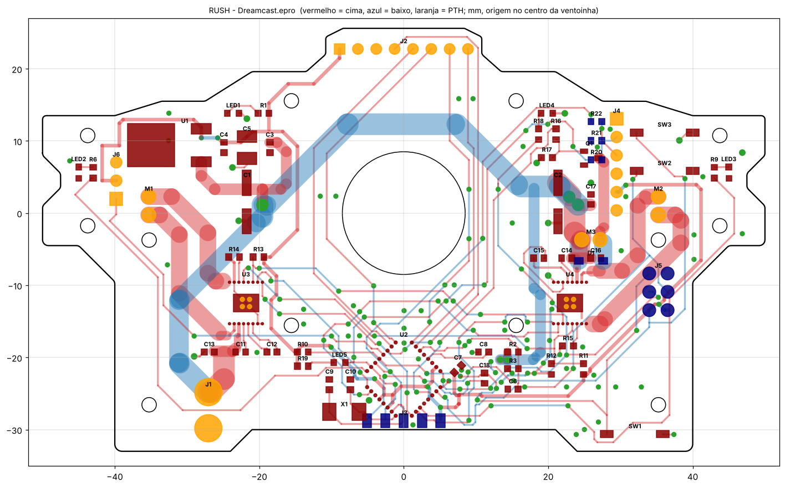

# Perseguidor — RUSH - Dreamcast

Placa do perseguidor feita a partir da placa do seguidor **RUSH - Saturn** (versão final, validada eletricamente). Dele vêm o esquemático e o roteamento. Do **RUSH perseguidor - entalhe A** vêm o contorno (100 × 58,6 mm) e o receptor IR.

Unidades em mm. A origem fica no centro da ventoinha, com +y para a frente.



## Arquivos
| Arquivo | O que é |
|---|---|
| `RUSH - Dreamcast.epro` | **versão atual** (EasyEDA Pro): edição do Erick de 14/11 + ajuste das presilhas |
| `origem/RUSH - Dreamcast 2026-11-14 (Erick).epro` | edição do Erick no EasyEDA, sem o ajuste |
| `origem/RUSH - Saturn - Final.epro` | seguidor validado (base) |
| `origem/RUSH perseguidor - entalhe A.epro` | perseguidor anterior (contorno e J6) |
| `ferramentas/gerar_dreamcast.py` | 1ª etapa: gerou o Dreamcast a partir do Saturn e do Rush (histórico) |
| `ferramentas/ajustar_presilhas.py` | 2ª etapa: aplica o ajuste das presilhas na edição do Erick e gera a versão atual |
| `ferramentas/conferir_netlist.py` | compara as ligações do esquemático com as redes do PCB |
| `ferramentas/figura_pcb.py` | figura de conferência do PCB |

**A fonte agora é o `.epro` editado no EasyEDA.** Para refazer a versão atual (precisa de `shapely` e `matplotlib`):
```bash
python3 perseguidor/ferramentas/ajustar_presilhas.py
```
```bash
python3 perseguidor/ferramentas/conferir_netlist.py "perseguidor/RUSH - Dreamcast.epro"
```
Daqui em diante, o caminho normal é editar no EasyEDA e trazer o `.epro` de volta para cá.

## Mecânica que limita as pontas
- **Presilhas da vareta** (`barilla_clamp` do EVA-RT):
  - ficam em pé: o parafuso vai nos furos (±43,75; −1,75 / 10,75) e o olhal segura a vareta 4,6 mm para fora, em x ≈ ±48,35;
  - vista de cima, cada uma ocupa x de ±41,35 até ±50,85 e furo ±2,25 em y, com 7 mm de altura (igual à camada Document do EVA-RT);
  - o braço de baixo apoia na placa, então **nenhum componente em cima nessas áreas**. Trilha e via com máscara podem passar.
- **Vão entre as presilhas:** y 0,5…8,5, de x = ±41,35 até o entalhe (±47,5). É o único lugar livre em cima, nas pontas.
- **Gearbox:** x ±30,5…±40, y −28,5…−1,78, cerca de 13,8 mm de altura acima da placa.

## O que mudou em relação ao Saturn
**Esquemático** (bloco 3, agora "LEDS DAS PONTAS E RECEPTOR IR")
- Saíram os 4 sensores de marca e o que era só deles: S1–S4, R4, R5, R7, R8, R23–R26, C19 e C20.
- Ficaram LED2/R6 (LED A, D2) e LED3/R9 (LED B, D7).
- Entrou o J6 (barra fêmea 1×3 para o KY-022: 1 = S, 2 = +5V, 3 = GND), na rede IR_A5 (pino 28, A5).
- A6 (pino 19), D8 (12) e D9 (13) ficaram marcados como sem ligação.
- O resto não mudou, inclusive R14/R15 = 910 Ω (ver ITRIP abaixo).

**PCB (versão atual)**
- O contorno é o do Rush (entalhe A). Furos e o restante do miolo são os do Saturn, com as edições do Erick (por exemplo, U1 em x = −31,5).
- **J6 em (−39,8; 4,5)**, centrado no vão entre as presilhas.
  - O corpo vai de x −41,05 a −38,55: fica a 0,30 mm das presilhas e a 0,33 mm da aba do U1.
  - A5: vem de (−40,7; −1,08) e sobe em x = −39,8 até o pino 1.
  - +5V: desce em x = −39,37 até y = 9,35, contorna o J6 pela esquerda (x = −41,75) e entra no pino 2.
  - GND: pelo pour.
- **LEDs nas pontas, no vão entre as presilhas:** LED2/LED3 em (±45,0; 5,6) e R6/R9 em (±43,0; 5,6), todos em cima e sem vias.
  - D2 e D7 chegam pelas diagonais que já existiam.
  - GND dos LEDs: pelo pour.
- **Pours:** as áreas de cobre de GND (em cima e embaixo) do Saturn foram restauradas, porque a edição de 14/11 não tinha nenhuma. Elas **precisam ser refeitas** no EasyEDA.

**Conferências feitas no script**
- Esquemático × PCB: as 50 redes com 2 ou mais pinos são iguais.
- Conectividade: todas as redes ficam numa ilha só, menos o GND, que se fecha pelos pours.
- Folga: nenhum par novo abaixo de 0,15 mm. A menor folga dos itens novos é 0,55 mm; a regra do projeto é 0,2 mm.
- Presilhas: nenhum componente de cima a menos de 0,3 mm delas.

## Para conferir no EasyEDA Pro
1. Abrir o `.epro` e refazer todos os pours. Confirmar que LED2.1, LED3.1 e J6.3 (GND) pegaram o pour.
2. Rodar o DRC.
3. Rodar "Atualizar PCB a partir do esquemático": não deve aparecer nenhuma diferença.
4. Conferir no 3D, com os STL:
   - presilhas × J6 e LEDs;
   - módulo KY-022 × gearbox. A placa do módulo, com uns 15 mm em y, pode descer até y ≈ −3 e chegar perto do topo da gearbox, dependendo de para que lado ficam os componentes dele.
5. Conferir se a cabeça do parafuso ou a porca embaixo das presilhas não pega nas trilhas de baixo que passam perto dos furos.
6. Arrumar as posições dos designadores na serigrafia, se for preciso.

## Em aberto
- **ITRIP (R14/R15):** com VREF = 2,0 V (15k/10k) e A_IPROPI = 450 µA/A (típico do DRV8874), ITRIP = 2,0 / (R × 450 µA/A):

  | R | ITRIP |
  |---|---|
  | 1,5 kΩ | 2,96 A |
  | 910 Ω (atual) | 4,88 A |
  | 820 Ω | 5,42 A |
  | 806 Ω (E96) | 5,51 A |

  Para o limite de 5,5 A, confira a tolerância do A_IPROPI no datasheet antes de escolher.
- **Firmware:** o IR fica no A5 (PC5/PCINT13), onde o EVA-RT 1.2.2 lê o sensor de curva pelo ADC. A leitura do receptor IR precisa ser escrita.
- Nome na serigrafia: a placa mantém o logo do IFSP e "Projetado por Erick Matos".
- Já existe no Saturn um toco de trilha de 0,78 mm, inofensivo, na rede LEDC_D13 (face de baixo, x = 13,07; y = 3,3 a 4,1). Pode ser apagado nas duas placas.

Baseado no RUSH - Saturn, derivado do [EVA-RT](https://github.com/EXOTIC-TEAM-MX/EVA-RT) (© EXOTIC TEAM MX), AGPL-3.0.
